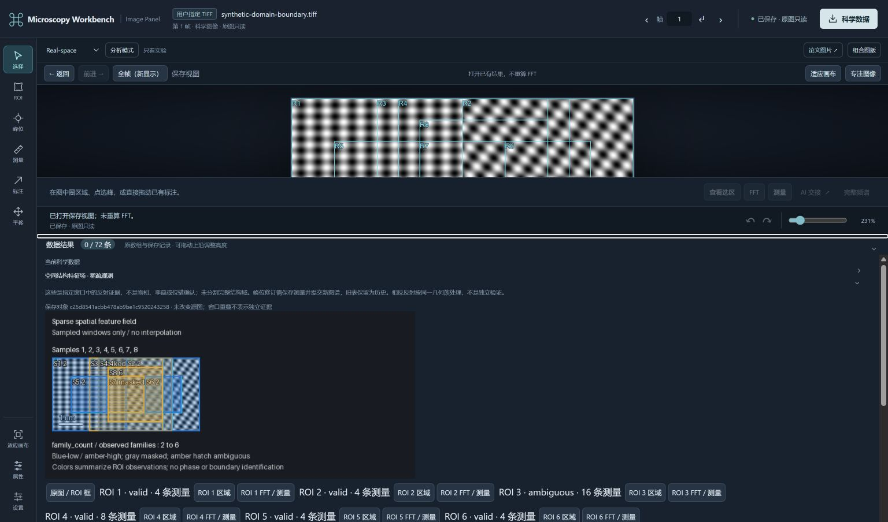

# Microscopy Workbench

**From microscopy images to traceable structural evidence.**

[English](README.md) · [简体中文](README.zh-CN.md)

Microscopy Workbench is an open-source, cross-platform workbench for scientific microscopy analysis. It combines numerical tools, persistent scientific records, and a local Image Panel. Through the **Model Context Protocol (MCP)** and installable **Skills**, compatible AI agents can use those same tools to organize an analysis—not replace its numerical or physical foundations.

The workbench runs on **Windows, macOS, and Linux**, without DigitalMicrograph, GMS, or the separate `mcp-dm` repository. **No AI model is needed** to inspect and measure images locally. Platform and scientific qualification scopes are recorded separately in the acceptance reports.



*R3 structural-field review in the local Panel, using a public synthetic test image. This is workflow evidence, not validation on real specimens.*

## What you can do

- **Inspect and measure microscopy data.** Open supported TIFF images and, with an optional reader, selected DM3/DM4 files. Preserve original arrays, data types, axes, signed calibration, and explicit frame/ROI selections. Compute local FFTs, detect/refine peaks and measure reciprocal vectors and spacings.
- **Build structural evidence and choose follow-up analyses (F1a / F4-lite).** Create bounded multiscale fields, candidate domains and finite boundary-support bands; append explicit ROI observations without recalculating unchanged FFTs. Read compact summaries or exact-manifest evidence pages, and obtain budgeted next-analysis proposals with explicit stopping rules.
- **Estimate single-domain physical fields (F2a).** Reuse a qualified saved FFT to extract geometric phase, projected displacement, finite Green–Lagrange strain and polar rotation. Reference choices, signed pixel metrics, invalid masks and pseudo-strain limitations remain explicit.
- **Inspect conditional projected topology (F3a).** Measure winding on explicit circuits in saved wrapped GPA bands. Version 2 evaluates strictly nested geometry groups separately and retains remote zero or unavailable observations. It does not confirm a material dislocation or a unique three-dimensional Burgers vector.
- **Compare saved sequences and review results.** Preserve explicit frame meaning and ROI correspondence (R2). Use the local Panel, scientific exports and Figure Composer to inspect source-linked evidence; frame indices are not assumed to be physical depth.
- **Resume reproducibly.** Scientific objects, request journals, source hashes, measurement dependencies and supported named AnalysisContext references preserve previous analyses. GPA/topology retain their exact provider object/request IDs; no unrelated context role is silently reused.

### How it fits together

```text
Researcher or optional AI Agent + Skills
                    |
            MCP server (TypeScript)
                    |
       Scientific tools (Python)
                    |
       Versioned scientific workspace
             /                 \
    Local Image Panel      Figure Composer
```

The Agent, when present, chooses and combines available operations. Scientific calculations are performed by explicit tools; the researcher can inspect and correct their results. Optional native DigitalMicrograph support lives in a **separate peer MCP server**, not inside this cross-platform core. The repository split and source attribution are documented in [MIGRATION_MANIFEST.json](MIGRATION_MANIFEST.json).

## Quick start — no Agent required

Requires **Node.js 18+** and **Python 3.10+** in a separate scientific environment.

```bash
git clone https://github.com/wuchqwq/microscopy-workbench.git
cd microscopy-workbench
npm ci
npm run build

python3 -m venv .venv
.venv/bin/python -m pip install -r requirements-images.txt

npm run inspect -- --source /absolute/path/to/image.tiff \
  --workspace /absolute/path/to/new-workspace \
  --python /absolute/path/to/microscopy-workbench/.venv/bin/python
```

Replace the example paths with real **absolute paths**. The inspector prints a private local Panel URL; keep its process running while using the Panel. On Windows, use `py -3 -m venv .venv` and `.venv\Scripts\python.exe`. See the [client setup guide](docs/CLIENT_SETUP.md) for platform-specific details and supported file types.

For optional GPA and the upstream GPA records used by topology, install `requirements-gpa.txt` in the **same independent Python environment**:

```bash
.venv/bin/python -m pip install -r requirements-gpa.txt
```

For development checks, run `npm run typecheck`, `npm test`, and—after setting `MICROSCOPY_PYTHON` to the absolute interpreter path—`npm run test:science`. Optional checks include `npm run test:gpa`, `npm run test:topology` and `npm run test:integration:f4-gpa`.

### Use it with an AI Agent

Connect the compiled MCP server to a compatible client, or install the packaged MCP + Skills plugin. The same science tools and local Panel are available with or without an Agent. See [client setup](docs/CLIENT_SETUP.md), [automation plugin setup](docs/AUTOMATION_PLUGIN.md), and the [Agent guide](README.agent.md). No model provider, API keys, or approval settings are silently configured by this project.

## Status and research roadmap

**Implemented in this checkout:** R2/R3 evidence workflows, F1a multiscale structural fields, F4-lite budgeted incremental analysis, F2a classical GPA and F3a versioned projected phase-winding evidence. The [development status](docs/DEVELOPMENT_STATUS.md) records the reviewed source commits and qualification boundaries. Historical acceptance reports describe their original branch state; they are not rewritten as new experiments.

**F3b first increment:** [bounded Sigma3 candidate and projected interface evidence](docs/PROJECTED_TWIN_EVIDENCE.md) reuses saved local FFT observations and actual simulated reflections, keeping untwinned alternatives and insufficient evidence explicit. It does not identify a unique 3D twin. See [research roadmap #16](https://github.com/wuchqwq/microscopy-workbench/issues/16). Broader F4-full analysis, Encoder training, foundation-model development and live instrument control are outside this increment.

**Not yet qualified:** actual GUI gestures in the documented relay, fresh-model use of the combined GPA/topology Skill, real-specimen accuracy and feature-specific interrupted-worker cases. Existing numerical, protocol or HTTP/PNG tests do not replace those checks. Deferred GUI qualification does not block development of independent scientific methods.

## Scientific scope

This is **research software**, not an autonomous microscope controller or a universally validated phase-identification system. It does not currently perform ptychographic reconstruction, general automatic phase/twin/dislocation identification, or live instrument control. Missing calibration stays missing; local spectral agreement is not proof of a phase, a defect, or a three-dimensional structure. Successful synthetic tests do not imply accuracy on real specimens.

Original scientific data remain separate from display images and annotations. Saved evidence retains provenance, units, hypotheses, and unknown/ambiguous states rather than converting them into confident-looking labels. V1 topology receipts retain their original interpretation; an explicit new request creates a v2 revision.

## Documentation

| Topic | Guide |
| --- | --- |
| Installation and MCP clients | [Client setup](docs/CLIENT_SETUP.md) · [Automation plugin](docs/AUTOMATION_PLUGIN.md) |
| Local images and review | [Image Panel](docs/LOCAL_IMAGE_PANEL.md) · [Researcher inspector](docs/RESEARCHER_DATA_INSPECTOR.md) |
| Structural and sequence evidence | [R3 fields](docs/SPATIAL_DOMAINS.md) · [Multiscale domains](docs/MULTISCALE_DOMAINS.md) · [R2 sequences](docs/SEQUENCE_PLUGIN.md) |
| Active analysis and physical fields | [Active analysis](docs/ACTIVE_ANALYSIS.md) · [Classical GPA](docs/CLASSICAL_GPA.md) · [Projected topology](docs/PROJECTED_TOPOLOGY.md) |
| Crystallography and publication | [Structure tools](docs/STRUCTURE_DIFFRACTION_TOOLS.md) · [Figure Composer](docs/FIGURE_COMPOSER.md) |
| Status and qualification | [Development status](docs/DEVELOPMENT_STATUS.md) · [F4/GPA integration](docs/F4_F2A_INTEGRATION.md) · [F3a acceptance](docs/F3A_ACCEPTANCE.md) |
| Private real-specimen preparation | [One-specimen intake, offline preflight and independent protocol](docs/REAL_SPECIMEN_INTAKE.md) — preparation only; real-specimen accuracy NOT_TESTED |

## License

[MIT](LICENSE). Reproducible issues, scientific counterexamples, and focused pull requests are welcome.
