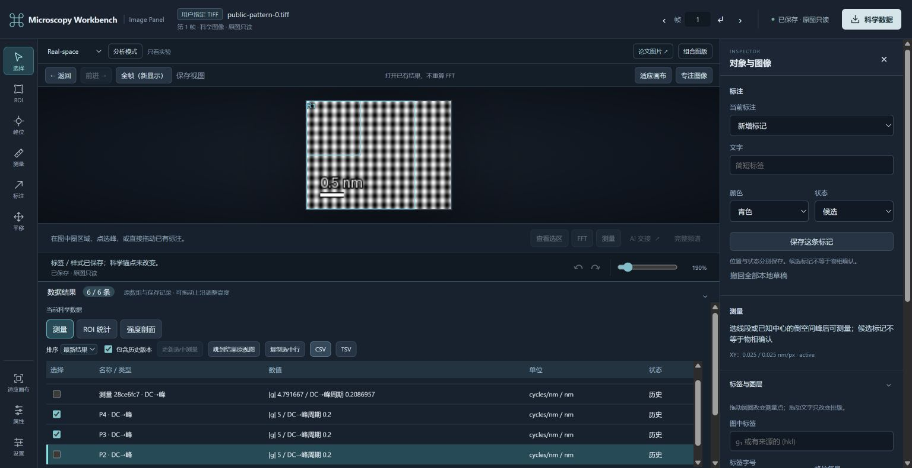
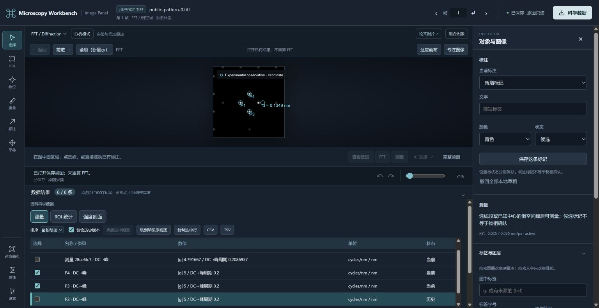

# Reusable automation plugin: first delivery

Issue [#8](https://github.com/wuchqwq/microscopy-workbench/issues/8), 2026-10-29.
Scientific/package implementation: `7661125` on `feature/reusable-automation-plugin`,
based on main `d4822d0`. This report is a subsequent evidence-only commit.
No main merge, old mcp-dm change, GMS/native execution or private specimen upload.

## What is reusable

An installed/local MCP package plus four shipped Skills now connects the existing
scientific tools. No model is called inside the plugin. A compatible host Agent
chooses strategy and can use the old individual tools directly.

New formal interfaces:

- `image_roi_propose`: 1–4 square scales, bounded coverage positions ranked by
  raw population contrast; exact rectangles and annotated source overview.
  This heuristic is **not** crystal-domain segmentation.
- `image_fft_batch`: 1–8 explicit windows, at most 4,194,304 total FFT pixels;
  source/ROI/FFT contact sheet and individual objects. An unchanged window on
  the exact same input revision can reuse its FFT from `previous_batch_id`.
- `image_peaks`: maxima on the original complex FFT amplitude using SciPy,
  explicit DC mask/threshold/separation and optional bounded log-quadratic
  sub-bin refinement. Returns peak tables and GUI-editable frequency anchors.
- `image_peak_measurements`: persists ordinary `image_measure` results and
  binds their references to the detected marks. No alternative measurement engine.
- `structure_compare_batch`: up to three explicit saved simulations compared by
  the existing matcher, using image measurement IDs instead of copied paths;
  fixed experimental scale/zero translation, explicit trial rotation/parity.

All scientific writes retain original request IDs. Parent and child records use
the existing provider journals, with child integrity checks on recovery. An
unknown interrupted batch is queried, not replayed. Independent children are
not presented as a transactional rollback. AnalysisContext remains reference-only.

Installation and exact launch commands: [AUTOMATION_PLUGIN.md](AUTOMATION_PLUGIN.md).

## Actual environment and acceptance

Windows 11, Node 24.16.0, Python 3.13.2; independent image and optional structure
environments. NumPy 2.5.4, SciPy 1.18.1, Pillow 12.3.0, tifffile 2026.10.15;
ASE 3.29.0 and diffsims 0.7.0. Actual Chrome, Codex CLI 0.165.0-alpha.1.2.
No packages were installed into GMS. The optional environment's location does
not supply old repository code: workers/modules came from this checkout or
the independently installed plugin snapshot.

| Scope | Result | Executed evidence |
| --- | --- | --- |
| Lightweight `npm test` | PASS, 264 / 4 existing SKIP | Registry, runtime, GUI, packaging and candidate contracts; no new skip |
| Final package/candidate focused Node tests | PASS, 7 | Relocated real stdio catalog, configuration and schema/boundaries |
| `image_peaks_test.py` | PASS, 4 | Known tones, independent log-quadratic example, signed anisotropy, no scale, invalid domains/nonfinite input, request recovery |
| `image_automation_test.py` | PASS, 5 | Two scales, direct DFT coefficient, reuse/revision, child corruption/identity refusal, missing export parent versus existing destination |
| `candidate_batch_test.py` | PASS, 4 | Actual ASE/diffsims, aligned versus rotated candidate, unknown/stale scale refusal, cross-process recovery and corrupt-child refusal |
| Existing `npm run test:science` | PASS | TIFF → signed calibration → FFT → NPY/direct DFT → new-client recovery → Panel HTTP |
| `npm run test:automation` | PASS | Actual plugin launcher → stdio → Python, two changed inputs, numerical comparison, images, cancellation/recovery and Panel HTTP |
| Native Codex plugin installation/discovery | PASS | Isolated local marketplace install, enabled plugin list and cached MCP path resolution |
| Fresh model session R2 | PASS for required chain | Installed package MCP plus packaged Skills, two self-chosen windows, measurements, candidate comparison, named context and annotated panel |
| Second fresh model session R3 | PASS | Given only task name, recovered context and exported without new FFT/scientific arrays |
| Actual Chrome GUI | PASS | Source ROI context → measured FFT → select row → drag one peak → new measurement/history → CSV → navigate saved views |
| Native-plugin-mode full model run | NOT_TESTED | Model runs used explicit MCP + packaged Skills configuration; installation/discovery is a separate scope |
| Mac/Linux actual client, GMS/native host, private specimen validation | NOT_TESTED | No such evidence is inferred from Windows synthetic tests |

R2/R3 are new CLI model sessions with no developer chat history and no temporary
scientific scripts. They used the actually installed package's MCP server and
project-local copies of its packaged Skills, ignoring ordinary user configuration.
Only the intended local synthetic tools were approved in those temporary client
invocations. Authentication was retained by the client; no secret was read/copied,
and real client configuration was not changed. This is a supported manual MCP +
Skills loading test, not a claim of an end-to-end native-plugin UI installation flow.

## Changed input and independent science

The permanent automation smoke generated two public uint16 inputs: 96×128 with
8-pixel tones, and 80×120 with 10-pixel tones. Region coordinates were derived
from tool proposals, not preset sample rectangles. Explicit synthetic scales
yielded a 0.2 nm geometric period. Both returned four maxima (two conjugate pairs),
ordinary measurement references, aligned matches and explicitly unmatched 45°
trial geometry, with residual tolerance fixed at `1e-6 Å⁻¹` throughout.
A direct mathematical DFT coefficient checked the saved complex array.

Cancellation was sent **after the FFT batch's durable prepared record existed**.
A different plugin client queried its original ID and recovered the same completed
batch/children. Recovery did not create additional scientific objects. Input TIFF
and original FFT hashes remained unchanged after display and single-peak revisions.

R2 used another input from [make_automation_trial.py](../examples/make_automation_trial.py):
72×96, X=+0.025 and Y=−0.025 nm/pixel explicitly declared synthetic. The Agent
selected 32×32 and 64×64 windows, Hann and mean removal. Measured horizontal/
vertical periods were approximately 0.199989/0.301943 and 0.200000/0.299162 nm.
Finite windows and interpolation do not establish localization uncertainty or
additional reciprocal resolution. The candidate matched the horizontal pair;
vertical peaks and 42 simulated reflections remained unmatched. Candidate status
stayed hypothesized and independent validation stayed `NOT_VALIDATED`.

R2 returned nine actual MCP image blocks; the Agent reported inspecting source,
ROI overview, FFT contact sheet and peak overlays, but not the simulation picture.
No shell scientific calculation was used. It saved `alternate-trial`, revision 2.
R3 received that name alone: nine successful tools recovered the same references
and exported complex128 NPY, PNG, manifest and provenance. All **114 pre-existing
provider files** retained their hashes, no scientific arrays were added, and the
exported NPY was byte-identical to the original FFT. Context remained revision 2.

## GUI evidence

The existing Panel read the same saved provider objects as the plugin. A real
mouse drag changed only P2: 0.2 nm became 0.13486381772971728 nm at
`fx=0.18537218077351847 cycles/pixel`. This was a deliberately displaced mark,
not an improved peak fit. P3/P4 retained their exact object IDs and 0.2 nm values;
the old P2 measurement remained historical. All marks remained hypothesized.
The exported CSV was independently checked against immutable provider manifests
and `0.025 / hypot(fx,fy)`, with unchanged source and FFT hashes.





[Actual browser-exported CSV](examples/automation-plugin/measurements.csv) ·
[Independent browser-result checks](examples/automation-plugin/verification.json).
These are public synthetic artifacts. Private loopback tokens, model transcripts,
local environments and scientific workspaces are deliberately not published.

## Retained failures and fixes

1. Initial batch overview omitted the annotation source identity. The worker
   refused it. Fixed explicit source-grid binding; original failure retained.
2. Independent review found incomplete source-identity metadata and aggregate
   recovery that did not check children. Fixed provenance and bounded child
   request/manifest/array/coordinate/calibration validation; adverse tests refuse
   changed arrays, altered child parameters and missing measurement journals.
3. Model R1 was stopped before opening data by the isolated harness's ungranted
   MCP approval. It is a FAIL, not a scientific pass. Scoped synthetic-tool
   configuration enabled R2 without changing the user's configuration.
4. R2's first simulation call omitted a required radius and was rejected before
   worker execution; the Agent supplied the parameter. Two extra export attempts
   were refused because the parent directory did not exist. The old error wrongly
   called this `OUTPUT_EXISTS`; the fix now returns `OUTPUT_PARENT_MISSING` with
   actionable existing-parent guidance. R3 exported successfully. R2 failures
   remain failures rather than being relabelled after the fix.
5. The browser driver's download waiter timed out, but the actual browser CSV
   existed. It was copied and verified, not regenerated as a substitute.

## Reproduce without a developer conversation

```sh
python -B examples/make_automation_trial.py /absolute/new-public-input
node tools/prepare_plugin.mjs --python /absolute/image-env/python --workspace /absolute/new-workspace --output /absolute/new-connection --structures --structure-python /absolute/structure-env/python
```

Load that generated MCP connection and packaged `microscopy-automation` Skill
in a compatible client. Ask it to inspect the public input, choose two scales,
measure peaks, compare the explicit candidate CIF, and retain a named context.
Provide the synthetic scale and assumed simulation conditions from the fixture,
not expected ROI coordinates, peak answers or object IDs. In another session,
ask to continue the saved task by name without recalculating FFTs.

For deterministic software acceptance:

```sh
npm test
python -B tests/image_peaks_test.py
python -B tests/image_automation_test.py
# Optional ASE/diffsims environment:
python -B tests/candidate_batch_test.py
# Set MICROSCOPY_PYTHON and MICROSCOPY_STRUCTURE_PYTHON to absolute interpreters:
npm run test:science
npm run test:automation
```

`MICROSCOPY_SMOKE_OUTPUT` optionally retains a new absolute output directory.
Retained successful runs leave owned loopback panels available for browser review;
their local report records process ownership. Without that option the test cleans
up its temporary outputs/helpers. Local full GMS/C++ regressions were not run.

## Next scope, not completed capabilities

This first delivery covers explicit spatial real-valued frames and saved external
FFTs. Full-grid detection ignores display zoom/filter/gamma. GUI-edited marks
must be remeasured from their new anchors; an old detector table is historical.
Unknown scale permits pixel frequencies/periods, not fabricated physical units.

Automatic global indexing/orientation search, multiphase domain segmentation,
twin-interface analysis, dislocation/GPA and registered adjacent-frame joint
analysis are **not implemented** by this increment. Existing frame selection and
same-ROI `image_compare` remain usable; sequence meaning is not inferred as depth.
The next useful increment is bounded adjacent-frame context and correspondence,
reusing these region/measurement records rather than inventing another pipeline.
