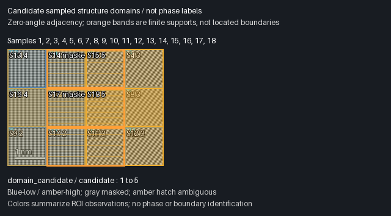

# F1a acceptance record

This record covers the bounded multiscale structural-field implementation for
Issue #26, based on TS main `3ac32f84487a7d89706cf670165427875eed40ba`.
Public analytic fixtures are synthetic software-validation data, not experimental
specimen accuracy or calibrated statistical confidence.

## Actual executed scopes

| Scope | Status | Evidence |
| --- | --- | --- |
| Analytic public fixture generator | PASS | Source cosine formulas, exact orientation matrix and piecewise boundary; float32 TIFF generated with no FFT. |
| Strict compiled MCP → Python F1a workflow | PASS, qualified scopes | Windows `r2` numerical path plus separately recorded post-fix continuation; exact final compiled full workflow also passed Linux CI. The old Windows full-run failure remains below. |
| Independent DFT / equal-budget uniform-window baseline | PASS | Every saved complex bin agreed within the unchanged `1e-7` absolute tolerance. Old uniform atlas arrays and measured vectors agreed exactly on the same 18 windows / 147,456 FFT pixels. |
| Saved measurement correction / FFT reuse | PASS | A committed correction fed a new field/map; all 18 FFT IDs/hashes and the other 17 measurement lists were unchanged. |
| Post-fix export / named new-session recovery / Panel HTTP | PASS | New explicit export operations used distinct paths/IDs; both completed in about 80.6 s. Eighteen-row CSVs and numerical support masks matched their saved records; named context revision 3 and original field restored in a new MCP client. Panel returned two real PNG blocks, one byte-identical to the exported domain PNG. Original timed-out request stayed incomplete. |
| Final compiled gap/context/recovery delta | PASS | Four 32-pixel windows with gaps: four unknown edges, no boundary or connecting domain merge, four FFTs only, unchanged source and FFT reuse; new-session named recovery. Revision-depth preflight is covered separately by the targeted Python tests. |
| Exact final code CI | PASS | All seven jobs at `d14a6ca`, including compiled full F1a MCP workflow, 13 targeted Python tests and frozen old-JS scientific workspace/schema compatibility. |
| Actual browser candidate navigation | NOT_TESTED | Computer Use stopped on URL-confidence validation; no alternate browser path was used. HTTP/image returns do not establish pointer gestures. |
| New model/plugin-discovery loading | NOT_TESTED | No claim based on a Node protocol client. |
| Real specimen accuracy / GPA / twin / dislocation / physical boundary uncertainty | NOT_TESTED | Outside this public synthetic F1a scope. |

## Reproduction and evidence boundaries

Follow [multiscale domain instructions](MULTISCALE_DOMAINS.md). The permanent
smoke retains raw request journals, immutable objects, generated inputs,
`report.json`, JSON/CSV/NPY/PNG export files and local Panel connection details.
Keep authentication fragments and private/local paths out of public excerpts.
Failed runs use new output directories; do not relabel or overwrite earlier
failures. Actual Browser, Windows, CI and model scopes are recorded separately.

The analytic matrix is `[[.8,-.6],[.6,.8]]`; source B is an exact proper rotation
of source A in reciprocal coordinates. Pixel-domain `+g/-g` form one family.
Single-domain translations change cosine phase but preserve local wave vectors.
A 32-pixel strip cannot be resolved as a pure B window by 64/128-pixel sampling;
mixed/unknown evidence is valid and no absence claim follows.

The default main plan has 18 windows, 64/128-pixel square sizes, 64-pixel stride
on a 192×256 frame, and 147,456 total FFT pixels. Both the new field and the
ordinary uniform-atlas baseline use exactly those windows and settings. Timings
include the actual work performed, including acceptance-only baseline runs;
window count alone is not a compute/performance measure. Worker startup is
unknown unless explicitly measured; record observed compute/render/tool times
without inventing provider-internal phases.

## Windows numerical results and preserved failures

The actual compiled package used an independent Windows Python environment and
formal MCP tools. The recorded `r2` main field required 39.266 s compute/validation
and 0.044 s render/write in one composition worker; its main map required
20.667 s compute/validation and 0.116 s render/write, with zero additional FFTs.
Startup remains unknown. The ordinary equal-budget three-atlas baseline took
30.893 s; it does not materialize the new domain graph and is not a claimed
speed ratio. These are observed times under this environment's load, not a
universal performance promise.

The two-orientation input produced two candidate components at each scale
(four total, **not four materials**). Its 24 same-scale neighbor edges were
16 compatible, three different and five unknown. Three finite boundary bands
all included the analytic X=128 interface; each extended from X=64 to X=192.
That is finite measurement support, not localization error or a confidence
interval. Coarse cross-boundary samples 13 and 16 were masked. Window-support
coverage was 100%; unknown support was 50%, with overlapping scales correlated.

Single A, phase-shifted A and globally rotated B controls each yielded one
candidate and no boundary. Constant and seeded-noise controls yielded four
unknown samples each, with no domains/boundaries. The square control retained
multiple submitted rotation alternatives. Tightening reciprocal tolerance from
0.003 to 0.001 cycles/pixel retained three boundary bands for the exact analytic
main input.

**Narrow-structure limitation:** the 32-pixel B strip was missed by the selected
64-pixel, 0.18-threshold control: one connected dominant-signature candidate and
no boundary were returned. Four samples were numerically usable; this does not
establish one homogeneous material. The finite sampling/detection failure is
retained, and no threshold was changed afterward to manufacture a success.
The method cannot exclude an unresolved narrow component.

Failure evidence remains in separate local run directories:

- `r1`: after an intentional budget rejection, the harness counted an unpublished
  reservation directory and tried to read its nonexistent manifest. The audit
  now counts committed manifests only. The budget refusal itself was correct
  and created no FFT; the harness failure was not relabeled PASS.
- `r2`: all numerical/control/revision checks above passed, followed by a real
  120.047 s domain-export timeout. Full elapsed time was 707.166 s, including
  acceptance-only baseline/control work. Original request
  `f1a-dd09f2608a-42` remained `prepared`; a new client's read-only original-ID
  query returned `INCOMPLETE_REQUEST` without replay. No replacement operation
  was automatically submitted; the old request and absent target stay preserved.

The complete `r2` smoke is **FAIL**. A focused repair and separately scoped
formal continuation supplied the successful export/recovery/Panel evidence
recorded below. The compiled `r2` numerical snapshot preceded
the final depth/gap preflight guards; those guards do not change its no-gap,
single-revision numerical path and received separate final qualification.

## Post-fix qualification and final code

The export repair reuses a successfully deep-validated F1a snapshot within one
operation, rechecking current file/journal identities when handing it to the
provenance walk. It does not weaken ordinary reads or skip changed dependencies;
payload, manifest and creator-parameter tamper tests reject. The 13-test file
passed before the final creator-journal hardening; the two affected hardening
tests passed again on the exact final code. Final CI also passed the full file.
No worker deadline or numerical tolerance was increased.

Explicit post-fix qualification used **different new export paths and request
IDs**, after the old runner closed. Field/map exports completed in 80.571 s and
80.637 s. A separate readback continuation verified JSON, 18 CSV rows per export,
uint8 sampled/unknown support masks, source rectangles and measurement references.
Its first readback harness had a test-label collision with provider `kind:export`;
that failed report is retained. The corrected harness uses a separate
`source_role` and rechecks existing exports without exporting again.

The final Windows readback continuation passed in 237.901 s. It saved context
`public-f1a-readback-20261030` at revision 3 through two legitimate CAS updates,
opened Panel HTTP, inspected two actual MCP image blocks, and restored original
field/current map in a fresh MCP client. Domain PNG SHA-256 was
`f8867ed511e18de3c323b7f03cece7ad3964f1e06ce7509ee4b71aa2609ee9d3`, identical
to the exported provider file. All original source and 18 FFT hashes remained
unchanged. This continuation computed no FFT; the entire Windows acceptance
workspace held 64 FFTs: 18 main, 18 explicit baseline and 28 control windows.
The original timed-out export stayed `prepared` and its target stayed absent.

The corrected point created five candidate components (three at scale 64, two
at scale 128), versus four before correction. These are versioned local
signature components, not a changed count of materials. The separate exact
final-compile gap/depth/context tests and
[seven-job CI run](https://github.com/wuchqwq/microscopy-workbench/actions/runs/40966544048)
qualify final code `d14a6ca`, including a successful full compiled F1a smoke in a
fresh Linux workspace. Initial CI failures at `76ef` were an overly exact
whole-catalog test for legitimate additions and the harness kind-label collision;
old schemas and old workspace bytes still receive strict compatibility checks.

Remaining practical limits: large revised exports take about 80 s on this
Windows setup; Panel opening took 91.550 s, while later current-state reads took
70 ms. Unknown scale/startup and unresolved narrow structures remain explicit.
Multiscale labels can overlap in the preview. Browser gestures, an actual new
model's plugin use and real-specimen accuracy remain **NOT_TESTED**; actual HTTP
and image evidence is not substituted for those scopes.

Public evidence: [sanitized summary](examples/f1a/acceptance-summary.json),
[domain CSV](examples/f1a/domain-map.csv),
[field CSV](examples/f1a/spatial-field.csv). These preserve real exported rows;
the summary is not an original immutable provider record. Complete original
journals/reports and the untouched failure evidence remain local.

