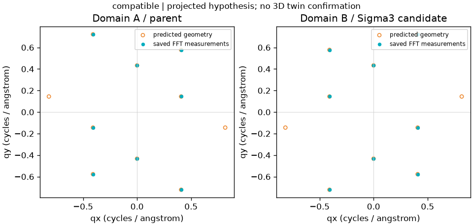

# F3b first-increment acceptance — 2026-10-30

Base: consolidated `origin/main` **f0acf9e** (PR #39). Independent branch:
`feature/f3b-twin-interface`; no old stack was merged again. Issue #41;
bounded method/API in [PROJECTED_TWIN_EVIDENCE.md](PROJECTED_TWIN_EVIDENCE.md).

## Actual environment and evidence

Windows x64; Node 24.16.0; independent Python 3.13.2, NumPy 2.5.4,
SciPy 1.18.1, ASE 3.29.0, tifffile 2026.10.15, pinned diffsims 0.7.0.
The existing optional structure requirements were installed only into
`F:/microscopy-workbench-env`; no GMS or user client configuration was touched.

The input is an openly reproducible 256x128 float32 sum-of-cosines fixture with
two 128x128 neighborhoods, four exact-bin reflection families per side, negative
Y scale and unequal XY pixel lengths. It is **not** an HRTEM contrast simulation,
atomic interface or real specimen. Reference FCC4/diamond8 models use a declared
synthetic `a=4 angstrom`, not a measured material lattice constant.

Public results: [acceptance/timings/failure history](validation/f3b/acceptance.json),
[analytic truth](validation/f3b/analytic-truth.json),
[full numerical comparisons](validation/f3b/comparisons.json),
[actual CSV](validation/f3b/reflections.csv),
[MCP-returned PNG](validation/f3b/projected-evidence.png).
The archived JSON/CSV are evidence snapshots; absolute local references inside
them are not an importable portable workspace. Reproduction creates fresh
authoritative provider journals using the commands below. Full original r1–r3
workspaces/reports remain in ignored local `analysis/2026-10-30-f3b-r*/`.



## Results

| Scope | Result | Actual evidence |
| --- | --- | --- |
| Independent analytic geometry | PASS, 13 tests | Hard-coded proper matrices, explicit q=hkl/a, positive FCC/diamond case, ordinary 40-degree non-twin grain boundary, cubic-equivalent representations, wrong/missing trace, noncollinear/Friedel controls, [111] projection ambiguity, unsupported motifs and fixed-scale/DC gates. No production solver/diffsims generated the expected truth. |
| Actual image-provider source adapter | PASS, 7 tests | Atlas, spatial field, incremental field and domain map; source/frame/ROI/current FFT/calibration binding, gap/corner refusal, absent/withdrawn scale, masked/truncated quality, spatial line binding and read-only file hashes. |
| Existing optional structure regression | PASS, 4 tests | Existing candidate comparison semantics, original-ID/new-process recovery, source and corrupted-evidence checks. |
| TypeScript build and targeted Node contract/registry/viewer checks | PASS | Added schema, configured provider scope, readonly paging, old tools direct; no central server dispatch change. |
| Existing lightweight Node test list | PASS, 318 passed / 6 conditional skips | 324 total, zero failures. Ran the compiled `package.json` test list after a fresh build; no redundant pretest build during the concurrent scientific smoke. Conditional platform/backend tests are not counted as passed. |
| Existing standalone scientific smoke | PASS | Actual TIFF → signed calibration → ROI FFT → 0.8 nm measurement → NPY/direct DFT → display revision → new-client recovery → saved Panel HTTP, source unchanged. HTTP is not browser gesture qualification. |
| Existing Unix CI-scope suite invoked locally on Windows | FAIL (platform scope) | 15 tests, 24 subcase errors: the Windows `bash` launcher exits 127 and Windows rejects the newline-containing filename case. This Unix-only suite was not modified or skipped; the existing Ubuntu CI job runs it in its intended environment. This failure is separate from F3b scientific/Node results. |
| Actual F3b stdio MCP → independent Python → real ASE/diffsims | PASS, r3, 131.3 s | Real saved field, two actual separately filtered simulations and both source-bound domain comparisons. Eight measured reflections per side match the independent signed-metric q oracle. |
| Projected candidate and wrong-interface revision | PASS | Positive reflection and interface compatible. A saved vertical line gives exactly 90-degree trace residual: interface/joint incompatible while reflection relation stays compatible. Old result/files remain byte-identical. |
| Original request and fresh MCP client | PASS | Conflicting parameters refuse; new client recovers original/revised IDs and saved image/structure objects. Four actual bounded page reads agree with committed unmatched-reflection JSON; reads create no objects or request journals. |
| Scientific arrays/source protection | PASS | Exactly two FFTs and two simulations in the F3b workflow; comparisons, revision, paging and recovery add neither. Source TIFF/CIF, frame/FFT/simulation arrays and old comparison hashes are unchanged. |
| Actual browser gestures/GUI editor | NOT_TESTED | Explicitly deferred; no Computer Use attempted and no safety stop bypassed. Existing saved overview/ROI/FFT IDs remain inspectable in Panel. |
| Fresh ordinary model/Skill comprehension | NOT_TESTED | Actual MCP clients and packaged Skill/catalog checks are not a model-session acceptance. |
| Real specimen/unique 3D twin/atomic coherence | NOT_TESTED / not claimed | No private specimen loaded or uploaded. A compatible projection remains a hypothesis. |
| F3b cancellation/lost-response/worker-interruption injection | NOT_TESTED | Existing coordinator/journal behavior is reused; successful fresh-client recovery does not establish new fault-injection coverage. |
| Native DM/GMS, macOS-specific execution | NOT_TESTED | No host connection, DLL change or GMS/C++ regression. |

## Failures retained and fixed

1. **r1 FAIL, production adapter:** simulation `parameters` contains normalized
   engine settings, not original MCP `object_id`. Valid input was refused.
   Fixed validation now uses the already hash-validated original request journal.
   The original r1 report hash/error is retained in public acceptance JSON.
2. **r2 FAIL, smoke harness:** the harness appended a write request ID to readonly
   `structure_info`. Fixed the harness; the schema and scientific checks were
   retained. Positive comparison and wrong-trace revision had already passed.
3. Independent review found full unmatched predictions available only as a
   local filename. Added `structure_twin_evidence`, a named/hash-checked readonly
   page with bounded offset/limit. Actual MCP r3 verifies this, without rerunning
   FFT, simulation or comparison.
4. Quality audit found that physical calibration alone must not promote an
   incomplete/ambiguous/masked saved observation. It now preserves numerical
   comparisons but downgrades the verdict to insufficient. An unresolved parent
   cannot become a joint identification merely because a trace mismatches.

No tolerance, truth, method baseline or failed assertion was relaxed.

## Reproduce (new workspace; no model or DM needed)

```powershell
npm ci
npm run build
$env:MICROSCOPY_PYTHON = 'F:\microscopy-workbench-env\Scripts\python.exe'
# Install requirements-structure-tools.txt in an independent environment if absent.
& $env:MICROSCOPY_PYTHON -B tests/test_twin_geometry.py
& $env:MICROSCOPY_PYTHON -B tests/test_twin_observations.py
node --test dist/tests/twin-contract.test.mjs dist/tests/candidate-batch-contract.test.mjs
$env:MICROSCOPY_SMOKE_OUTPUT = 'C:\scratch\f3b-new-run' # must not exist
npm run test:twin
```

The smoke uses the actual packaged plugin server and public tool schema;
`structures:true` is confined to its temporary plugin config. It saves exact
request IDs, original journals, numeric JSON/CSV/PNG, source hashes, timings and
new-client recovery results. The generator refuses existing fixture files.

## Limits and next discriminating work

First scope is a specified ideal conventional FCC/diamond Sigma3 candidate,
not all twin systems or an orientation search. Unknown physical calibration
preserves pixel observation but cannot supply physical twin evidence. Distinct
predictions can be indistinguishable in one projection; [111] is an explicit
counterexample. Interface traces constrain only an explicitly sourced edge-on
projection and do not establish atomic coherence. General chemistry, stacking,
thickness, dynamical scattering and unique 3D twinning need additional evidence.
The most useful next qualification is a researcher-chosen, calibrated two-domain
case with an independently justified projection/interface and discriminating
reflections; GUI gestures stay separate. No F4-full or model training was added.
