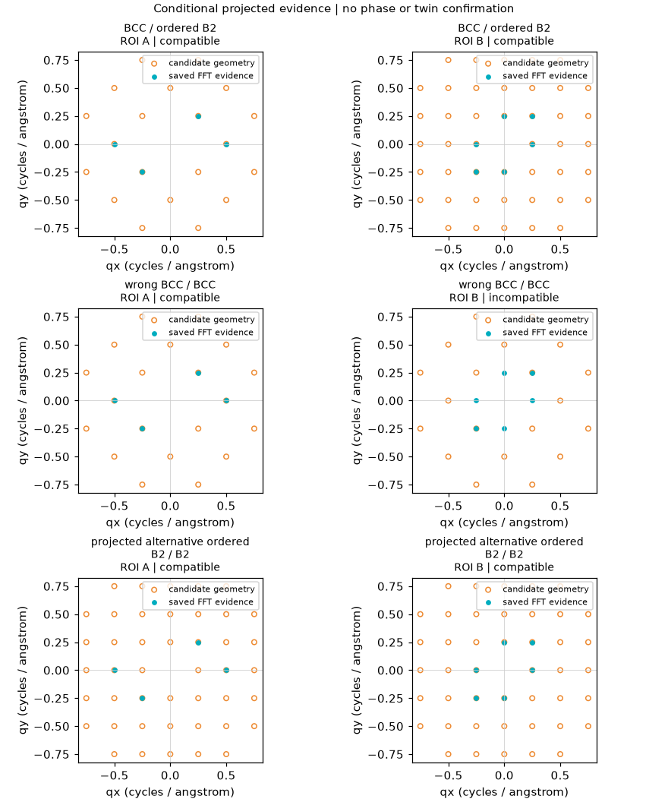

# General crystallographic evidence acceptance

Independent branch from main `9fbc769`; #44/#45/#46 were open and unmerged at
development start. No stacked branch is a dependency. No main or old PR merge.

Windows x64, Node 24.16.0; independent Python 3.13.2, NumPy 2.5.4, SciPy 1.18.1,
ASE 3.29.0, diffsims 0.7.0, diffpy.structure 3.5.0. No dependency was installed
in GMS Python and no user client configuration or original specimen was changed.

## Reproduce

```powershell
npm ci
npm run build
$env:MICROSCOPY_PYTHON='F:/microscopy-workbench-env/Scripts/python.exe'
$env:MICROSCOPY_SMOKE_OUTPUT='F:/microscopy-workbench-crystal-evidence/analysis/my-new-general-run'
npm run test:general-crystal
```

Use a **new** absolute output directory; existing evidence is not overwritten.
The runner creates public analytic float32 cosine TIFFs and exact supplied
structures locally. Real diffraction is generated separately with actual ASE /
diffsims through the compiled MCP stdio server, not an ABI substitute or PNG
comparison. The analytic images are not physical HRTEM contrast simulations.

Preregistered fixture conditions are embedded before the first run: two128px
windows, exact signed-anisotropic sampling for HCP, explicitly supplied [001]
orientations, reciprocal radius1/angstrom and residual tolerance0.005/angstrom.
No threshold, cell rebasing or truth is changed to make a failed trial pass.

## Validation record

| Scope | Result |
| --- | --- |
| Explicit structure/cell/occupancy/symmetry qualification | PASS, 11 independent tests, including FCC/BCC/HCP and ordered NiAl geometry; synthetic certificate fixtures are not actual scattering qualification |
| General geometry, projection ambiguity, finite direction families and frozen input binding | PASS, 13 tests |
| Orientation-reference recursion guard | PASS, 4 isolated unit-boundary tests including removal-of-guard negative control; not a full journal or interruption injection |
| Existing F3b geometry/source/direction regressions | PASS, 35 tests, no threshold or historical policy change |
| New/old structure Registry, schemas and scoped recovery | PASS, 11 targeted Node tests |
| Lightweight npm suite | PASS, 320 passed / 6 conditional skips / 326 total |
| Strict typecheck and compiled build | PASS |
| Copied compiled provider with frozen JS schema/workspace | PASS, 2 tests |
| Existing actual standalone science/DFT/export/recovery/Panel HTTP | PASS; HTTP is not browser gestures |
| Actual MCP → Python → ASE/diffsims on BCC/B2 and HCP ROI pairs | PASS, final r2 114.483 seconds; direct HKL/q and signed pixel-frequency oracles |
| Original-ID conflict, changed-ROI refusal, immutable revision and fresh-client recovery | PASS; exactly 4 FFTs / 3 simulations; 46 scientific files and 621 recovery files unchanged |
| Earlier F3b positive and wrong-interface requests recovered with current MCP | PASS; 2 saved objects, original compatible/incompatible statuses, all 256 files unchanged, no new requests/FFT/simulation |
| Frozen F3b/matcher/orientation code, schemas and published historical evidence | PASS, 12 files byte-identical to main; preservation manifest retained |

The [actual numeric acceptance](validation/general-crystal/acceptance.json),
[independent analytic truth](validation/general-crystal/analytic-truth.json),
[full matched/unmatched comparisons](validation/general-crystal/heterophase-comparisons.json),
[CSV](validation/general-crystal/heterophase-reflections.csv),
[old F3b recovery](validation/general-crystal/legacy-f3b-recovery.json) and
[historical file hashes](validation/general-crystal/legacy-preservation.json)
are public synthetic evidence snapshots, not portable provider journals. The
complete r1/r2 workspaces and raw reports remain in ignored local `analysis/`;
the public summary binds their original SHA-256 rather than rewriting them.



The BCC/B2 pair is compatible, wrong BCC/BCC is incompatible, but the B2/B2
projected alternative also fits the selected geometry. Consequently the finite
candidate-set verdict is **insufficient_evidence**, not unique phase identity.
The HCP/HCP case is compatible for its explicit projection; a one-direction
subset is insufficient. All full unmatched predictions remain saved and do
not become negative experimental intensity evidence.

New general-tool FCC geometry is covered analytically; its prior actual
simulation/F3b path remains unchanged and is separately exercised by CI. A
new general-tool FCC positive specimen or intensity comparison is NOT_TESTED.
No all-structures/cutoffs claim follows from these finite cases.

## Integration problems retained and corrected

An initial build exposed readonly schema-union typing and the runner's spread
typing; corrections were type-only. The first complete actual MCP run passed
scientific checks, but its long candidate titles overlapped. The
[initial PNG](validation/general-crystal/initial-title-overlap.png) is retained;
the fix only wraps and sizes titles. An independent audit also found a possible
recursive orientation reference; kind/ID checks now refuse it before recursive
admission. The isolated negative control does not claim actual interruption.

Final r2 repeats the same preregistered scientific inputs and settings after
both fixes. All 12 committed frame/FFT/simulation arrays and reflection files
match r1 byte-for-byte. No scientific assertion was dropped or tolerance
relaxed. An evidence-packaging script initially encountered a refused request's
empty uncommitted directory; it now explicitly excludes empty uncommitted
directories and refuses uncommitted NPYs, without changing scientific outputs.

Exact final-HEAD CI results and the PR dependency snapshot are attached to the
PR after push; earlier-HEAD CI is not substituted for that result.

## Qualification boundaries

Public analytical geometry, actual scattering simulation, protocol/PNG and
human interpretation are different evidence. Geometry-compatible candidate
pairs remain hypotheses; multiple compatible projections stay insufficient.
Incomplete reflections or unverified group metadata are not filled in.

Real specimens, unique 3D orientation or phase identification, disorder/partial
occupancy scattering, all space groups/cell cutoffs, human browser gestures,
new model-session Skill comprehension, actual interrupted-worker injection,
native DM/GMS and dedicated Mac execution are **NOT_TESTED** or outside scope.
The historical unknown-child unit test covers saved-receipt semantics, not
actual process interruption. No such result is inferred from successful recovery.

The [support matrix and scientific limits](GENERAL_CRYSTALLOGRAPHIC_EVIDENCE.md)
are part of the API. Existing F3b Sigma3 rules and historical numerical evidence
remain unchanged; generic projected relations are not renamed twins.
