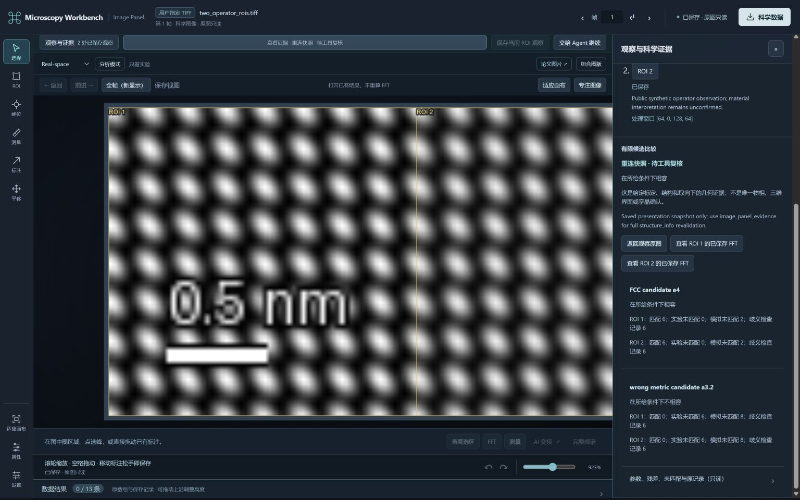
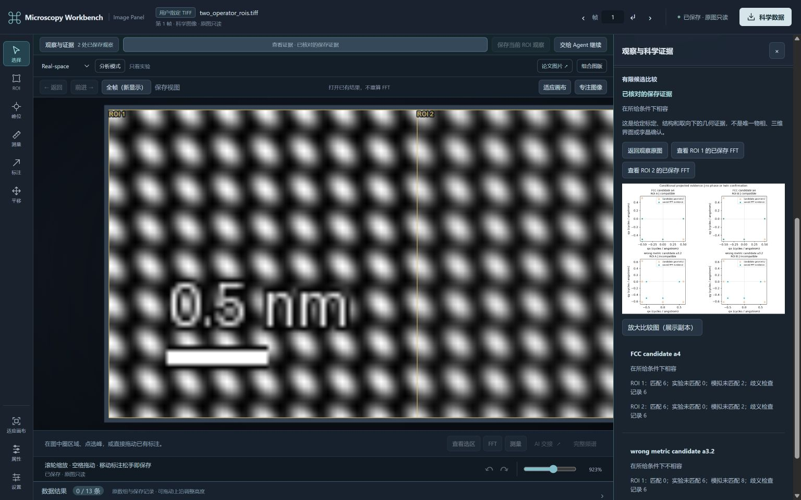

# Registered Inspector and Panel recovery

This candidate adds explicit recovery of a stopped, registered local Panel helper
and registers newly created Researcher Inspectors with the same MCP bridge.
The scientific provider remains authoritative. Reopening a helper reads saved
objects; it does not repeat FFT, measurement, simulation or export operations.

## Start and reopen an Inspector

Build the checkout once, then use the existing independent image Python
environment. These are example paths, not experimental data or credentials:

```powershell
npm run build
npm run inspect -- --source 'C:\data\sequence.tiff' `
  --workspace 'C:\analysis\my-sequence' `
  --python 'C:\analysis\image-env\Scripts\python.exe' --frame 1
```

Open the loopback URL printed by the command and keep its terminal running.
The normal entry now publishes an owned registration. With the MCP image
provider configured to this **same image workspace**, `image_panel_current`
can address this Inspector's actual Panel. Retain the returned `panel_id`
internally; users do not have to enter it in the GUI. If several registered
Panels are live, the Agent must specify the retained ID rather than select the
most recent window. This does not automatically wake a model.

Finish with Ctrl+C for normal closure. To reopen, keep the workspace intact:

```powershell
npm run inspect -- --workspace 'C:\analysis\my-sequence' `
  --python 'C:\analysis\image-env\Scripts\python.exe'
```

For a registered Inspector, this admits the exact previous helper checkpoint,
retains the logical Panel ID and creates a new helper generation. A still-live
old helper is refused. The initial source, frame, DM dataset and plane selectors
cannot be changed to disguise a different input as recovery. Use a separate
workspace for a different source. Do not edit the registry or copy a checkpoint
to manufacture ownership.

## Explicit MCP recovery of a stopped owned helper

The additional tool is:

```text
image_panel_resume({panel_id, request_id})
```

The caller saves a new request ID **before** submitting this explicit viewing
operation. No object, path, URL, script or scientific-processing parameter is
accepted. The tool resumes the exact checkpoint named by the selected owned
registration; it does not pick a recent object or render a replacement preview.

After timeout or cancellation of waiting, query `image_panel_resume` with the
**same original arguments**. Querying a submitted or failed request never starts
another helper. An unresolved launch remains unresolved unless its exact
already-published helper generation can establish the outcome. A failed original
ID continues to report its original failure, even if the environment later
changes. A competing new ID cannot bypass an unresolved per-Panel launch claim.

`image_panel_open` retains its old semantics: recovering its original request can
read a live logical Panel, but never restarts a stopped one. It is not a substitute
for `image_panel_resume`. Completed `image_panel_show`, `image_panel_evidence`
and resume receipts describe their original operations; they are not proof of
the latest visible state. Call `image_panel_current` separately.

## What is restored and what must be revalidated

Owned connection schema v2 binds `panel_id`, `helper_session_id`, `generation`
and one exact checkpoint within the configured workspace. The replacement has
the same logical Panel ID, a fresh helper session/generation and rotated browser
and private evidence capabilities. Use the newly returned URL; do not reuse a
copied old token. Connection files are private local records, not shareable
scientific evidence.

The helper restores the exact saved image, frame identity, selection and persisted
draft state. Draft revision advances and an interrupted gesture is no longer
marked active. Pending saved results remain pending; they are not silently
accepted. Recent statistics/profile references and scoped research-observation
references are read back through their providers. A mismatching reference is
refused or reported unavailable according to its existing result contract.
No transient browser undo stack or unsent mouse movement is promised recoverable.

A crystal evidence checkpoint returns as **`restored_unvalidated`**. It does not
become current merely because its old card or original receipt was recovered.
To reattach it, the Agent uses a saved new `image_panel_evidence` request against
the current object/draft revision. That operation re-reads the explicitly
configured structure provider and checks the saved scientific dependencies,
frame, ROI, calibration and recorded revisions. Unsaved drafts or stale evidence
remain guarded. This is a new attachment operation, not a replay of the old one.

## Compatibility and migration

| Existing record | Behavior |
| --- | --- |
| Live registered v1 Panel | Existing current/show/open-recovery behavior remains; v1 has no qualified owned checkpoint for resume. |
| Stopped registered v1 Panel | Resume is refused. Recover saved scientific records, then explicitly open the chosen saved object in a new Panel. |
| New owned v2 Panel/Inspector | Explicit stopped-helper resume or registered Inspector reopen uses the exact owned checkpoint. |
| Old unregistered Inspector archive | Saved-object recovery remains available through its existing same-workspace command; formal same-window MCP reattachment stays **HOLD / `legacy_unregistered_readonly`**. No registration is invented. |
| Failed or unknown scientific request | Query its original provider request; reopening a Panel never re-executes it. |

For an old unregistered Inspector archive, “read-only recovery” describes loading
the existing saved records. It does not mean every GUI processing control is
disabled. Preserve that archive. A new Inspector workspace can open the same
explicit source with a proper registration, but that is a new analysis, not a
claim that the former Panel or its unsaved state was recovered. An existing saved
object can instead be presented through an explicitly new `image_panel_open` in
its original image workspace. Neither path repairs old ownership retrospectively.

## Baseline and candidate acceptance

The before case was reproduced on actual main
`14613c4f5fba5af941568d5c71413928c627bd9d` using a fresh public 16×16 float32
analytic TIFF, the stock compiled plugin stdio MCP, real Python and the default
registered-helper launcher. After an explicitly authorized **controlled forced
stop of that exact newly created idle helper**, querying the original open and
current requests failed without restarting it. The original registry/request
bytes and all nine scientific files remained unchanged. Independently, the
public Inspector returned `panel_id: null`; formal MCP current reported zero
registered Panels. An independent TIFF/NPY comparison preserved exact float32
values. This establishes the baseline gap, not successful cold recovery.

Normal closure and the disposable forced-stop experiment are separate evidence.
The forced-stop case does not qualify interruption of an active scientific
worker, power loss, arbitrary process-tree termination or safe forced shutdown
of a user's work. The implementation does not add a process-kill or shutdown MCP
tool.

Candidate positive acceptance is recorded separately from this baseline:

| Candidate check | Actual result on Windows |
| --- | --- |
| Real MCP registered-helper cold resume, original-ID recovery and unchanged scientific files | PASS: [73.74 s receipt](validation/panel-recovery/registered-helper.json); generation 1 → 2, 430 science files unchanged, 12 original science requests recovered. |
| Public Inspector CLI formal same-window MCP reattachment after cold reopen | PASS: [86.76 s receipt](validation/panel-recovery/inspector-cli.json); documented no-source cold reopen, same logical Panel and saved view, 6 startup files unchanged. |
| Full crystal evidence readmission after `restored_unvalidated` | PASS: both process tests show `current → unvalidated_snapshot → current`; original resume receipt remains historical/unvalidated. |
| Actual Chrome open/refresh and evidence status | PASS: [browser receipt](validation/panel-recovery/browser.json), same tab shows pending snapshot, then fully admitted current evidence, including after refresh. No drag or human-usability claim. |
| Normal default Inspector API close after the Chrome check | PASS: public `close()` completed and its host process exited 0. This is separate from the forced CLI/helper cold tests; CLI Ctrl+C was not qualified here. |
| Real model session, human usability, macOS, private specimen or DM | NOT_TESTED by this recovery work |

These entries come from actual processes/providers, not unit-test substitution. The focused
ownership tests use controlled read-only providers and loopback helpers. Negative
checks include live/legacy refusal, generation/checkpoint mismatch, cross-client
claims, cancellation of waiting, unknown launches and interrupted preflight.
The interrupted-preflight fixture is not a real process-crash experiment.

The fixture is public analytic float32 `[64,128]`, two ROIs `[0,0,64,64]` /
`[64,0,128,64]`, signed scales X `+0.025`, Y `-0.025 nm/px`. It retains two
FFTs and two actual diffsims simulations throughout all recovery operations.
Independent all-bin direct DFT errors are `6.33e-11` / `5.86e-11` under the
unchanged `1e-7` limit. [Scientific IDs, request IDs and file hashes](validation/panel-recovery/scientific-identities.json)
and the [independent audit](validation/panel-recovery/independent-numeric-audit.json)
are separate from display screenshots. Conditional candidate compatibility is
not phase identification or twin confirmation.

Two acceptance-harness failures remain published: [r1](validation/panel-recovery/harness-r1-failure.json)
counted incomplete failed-child directories as completed objects; [r2](validation/panel-recovery/harness-r2-failure.json)
passed a calibration wrapper to annotate, which the science provider correctly
refused. The final run explicitly reused the same completed fresh synthetic
science and used a new ID on the valid rendered view. The rejected original
request remained failed and query-only; no tolerance, algorithm or failed
scientific record was changed. Original baseline failures are preserved in
[baseline-before.json](validation/panel-recovery/baseline-before.json).




## Reproduce the bounded Windows process check

Build and use an independent Python environment with the existing image and
optional structure requirements, including the qualified diffsims dependency:

```powershell
npm ci
npm run build
$env:MICROSCOPY_PYTHON='C:\analysis\image-env\Scripts\python.exe'
$env:MICROSCOPY_SMOKE_OUTPUT='C:\analysis\new-owned-panel-trial'
npm run test:panel-recovery
$env:MICROSCOPY_INSPECTOR_RECOVERY_BASELINE=$env:MICROSCOPY_SMOKE_OUTPUT
$env:MICROSCOPY_SMOKE_OUTPUT='C:\analysis\new-inspector-trial'
npm run test:panel-recovery
```

Both output directories must be new. This opt-in Windows test deliberately
force-stops **only its own newly created idle disposable Node helper** after
rechecking executable, exact arguments, PID and creation time. Do not point it
at a user-owned helper; it does not start or stop DM. The default command makes
fresh analytic data; an explicit `MICROSCOPY_PANEL_RECOVERY_SCIENCE` may reuse an
already completed public fixture for diagnosing the harness without copying or
rewriting it. Reused science is stated in the receipt. It is not a replacement
for a fresh-science first run.

For manual Chrome verification, use the same-workspace Inspector reopen command
above, open its newly printed URL, observe the pending evidence badge, then use
formal `image_panel_current` and a **new pre-saved** `image_panel_evidence` ID.
Refresh only after admission and compare the two statuses. Do not edit registry
files to attach old unregistered archives. All local connection URLs/tokens
remain private and are excluded from the public receipts.

Candidate checks: typecheck/build PASS; focused recovery tests 16 PASS;
lightweight `npm test` 383 PASS / 6 conditional SKIP; frozen-package compatibility
2 PASS; independent `test:science` PASS. This PR is based directly on main
`14613c4`; independent CI/Mac checklist PR #50 is neither merged nor modified.
At the audit, main itself had no recorded checks; #50 head `6ea7ff5` had its two
successful workflows. Inspect this candidate's exact PR-head CI separately.

Implementation references: [owned registration/checkpoint rules](../lib/panel_ownership.mts),
[formal MCP tools and original-request recovery](../lib/image_panel_mcp.mts),
[helper restore and draft admission](../tools/image_panel.mts),
[Inspector startup/reopen](../tools/researcher_inspector.mts), and
[focused ownership tests](../tests/image-panel-ownership.test.mjs).
