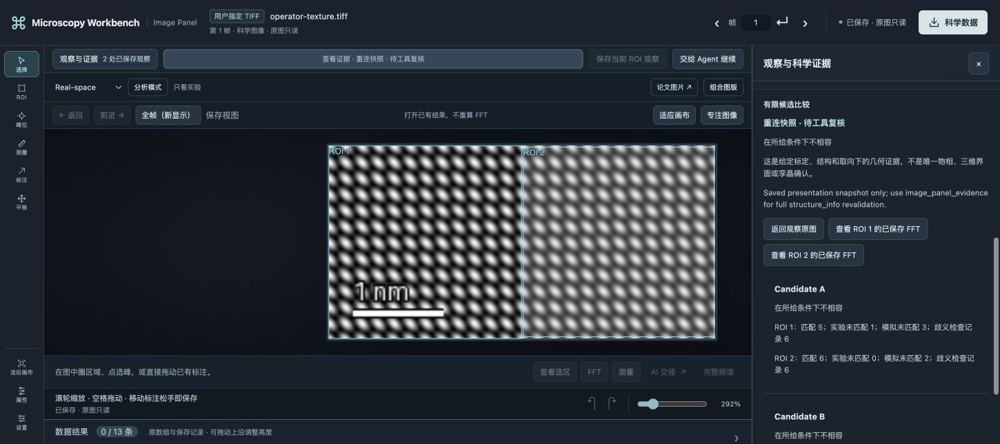
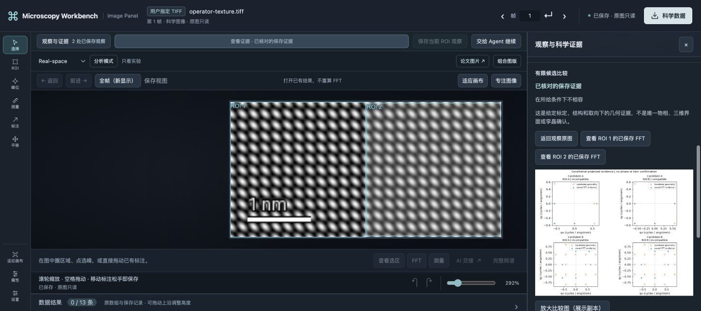

# macOS candidate qualification and client setup corrections

Executed 2026-11-01 on the target Mac: macOS 26.6 (25G72), Apple M5 arm64,
24 GiB, Node 22.23.4/npm 10.9.9 and independent Python 3.13.18. This records
**candidate** `c1651b5346df55e91602d5c32b5d2f73e659bdd5`, tree
`e2190e42fff936df7cbfe0d38af6daacc9ed5548`, not a later main SHA. PRs #50/#51
were still open. No merge, tag, private specimen or DM/GMS connection was used.

## Target-machine results

| Check | Actual result |
| --- | --- |
| Locked `npm ci`, typecheck, `npm test` with pretest build | PASS; 395 tests, 5 existing conditional skips, zero failures |
| Independent image science and frozen compiled compatibility | PASS; compatibility 2/2, full real Git history |
| Inspector/ownership focused regressions | PASS 23/23 |
| Explicit optional general/manual crystal, GPA, topology, F4-GPA integration | PASS, same independent environment; requirements unchanged |
| Real Chrome, two ROI reasons, finite comparison, peak correction and refresh | PASS, Codex-operated gestures |
| New model after peak correction | PASS, 15 formal MCP calls/19 image blocks; no non-MCP actions |
| Normal CLI SIGINT, documented no-source reopen, same Panel and new evidence admission | PASS, exit 0; generation 1→2 and capabilities rotated |

[Sanitized qualification receipt](validation/macos-candidate-20261101/mac-qualification.json)
records scope and versions. Original TIFF and float32 NPY matched exactly;
independent all-bin DFT errors were 5.046e-10/3.767e-10 under the existing 1e-7
limit. The browser moved one ROI1 peak from 0.125 to 0.13927734865173863
cycles/pixel; its period changed from 0.18 to 0.16154816427659735 nm. Candidate A
changed to 5 matched/1 unmatched in ROI1; ROI2 retained 6/0 and all six measurement
IDs. Both FFT arrays and both simulations were reused. The existing aggregate
comparison API generates four new candidate×ROI child receipts on revision;
this is not a claim that ROI2's child comparison was never executed.

Gamma 1→1.2, label arrangement, pan/zoom and refresh preserved 433 prior files;
only a new display view and presentation annotation were added. Normal reopen
preserved 441 scientific files and did not submit science. The browser first
showed an unvalidated snapshot; only a new formal `image_panel_evidence` made it
current. Original scientific/presentation requests remained historical.

These screenshots qualify the pinned candidate above. The following launcher
correction has a separate fresh-model test; it does not retroactively replace
the original browser/process evidence.

## Reproduced setup failures and bounded fixes

1. The opt-in manual-crystal qualifier placed its new model session outside Git
   but omitted `--skip-git-repo-check`. The installed CLI refused before starting
   a model. The flag is now scoped to that isolated invocation; read-only sandbox,
   supplied Skills, tool allowlist and no model override remain unchanged.
2. Its Panel prompt required the first pixel-only observation view even after
   adding an explicit scale. Actual presentation correctly refused
   `different_calibration_revision`. The corrected prompt first creates a new
   saved marked view with that same calibration record, verifies the old ROI
   anchors/reasons, and uses current object/draft guards before science. The
   original view stays pixel-only and immutable. No admission guard was relaxed.
3. Global `codex mcp add` can reserialize unrelated MCP tables. The new
   [append-only registrar](../tools/register_codex_mcp.py) uses a full private
   backup and preserves original TOML bytes. Dry runs, duplicate-name refusal,
   observed concurrent edits, empty allowlists/custom fields and packaged paths
   have disposable-file regressions. See [client setup](CLIENT_SETUP.md).

A **direct stock fixed-launcher** run in a fresh non-Git output directory passed
with a new actual model: 24 MCP calls, 17 image blocks, zero failed calls and no
non-MCP actions. Its initially pixel-only saved observations were prepared via
the formal fixture API, not new browser gestures. It established the new marked
calibrated view before its atlas, preserved all 17 prior files and original ROI
IDs/anchors/reasons, and attached current/validated evidence to the same Panel.
It used exactly two FFTs/two simulations; independent DFT errors were
4.389e-10/5.796e-10. [Independent receipt](validation/macos-candidate-20261101/fixed-launcher.json)
binds this result to the qualifier file hash. The host harness's first metadata
extraction assertion failed after model success; that failure was retained and
the same completed run audited read-only, without replaying model or science.

The corrections passed local typecheck, rebuilt `npm test` and `test:science`;
the new setup/launch regressions also run on Windows/Linux CI. Inspect the PR's
exact final-head checks rather than relabeling candidate results as main checks.

## Local environment correction and remaining limits

Installing Node22 initially upgraded a shared Homebrew library and required a
temporary old-library link for Node24. A supported Homebrew patch update of
Node24 to 24.22.2 removed that dependency; the temporary link was removed.
Node22's binary stayed unchanged, both active arm64 runtimes passed linkage,
crypto/zlib/TLS probes, and no shell profile or scientific dependency changed.
Old kegs were retained; rolling back the old Node also needs its matching old
dependency path. This machine repair is separate from repository source.

The installed Codex CLI's [matching-tag source](https://github.com/openai/codex/blob/rust-v0.166.0-alpha.5.1/codex-rs/cli/src/mcp_cmd.rs)
shows whole-MCP-map serialization, including omission of empty/default fields.
This explains a preservation risk but cannot prove every historical difference:
the first installation retained only a fingerprint, not the original TOML.
That **historical preservation HOLD remains**. Current MCP reads work and a new
full private current-state backup exists; it is not a reconstruction of the old
state. The new registrar neither guesses a restoration nor clears this HOLD.

Main freeze awaits the relevant merges and exact-main CI. Human usability,
automatic Skill/plugin discovery, active-worker crash/power loss, Mac forced
helper termination and independent real-specimen physics remain NOT_TESTED.
Normal Inspector reopen was qualified; the alternative `image_panel_resume`
entry was not tested on this Mac. Finite geometric compatibility does not
identify a unique phase, twin or 3D structure. Local config backups, loopback
URLs, tokens and raw model logs are excluded from the published receipts.

## Post-review integration state (separate from pinned Mac execution)

After the machine qualification above, main received #50 (`65aa0f4`) and #51
(`b21939b`). PR #52 was retargeted from the #51 branch to that updated main;
its incremental diff still contains only its client/launcher/setup changes.
Small documentation fixes distinguish the now-merged #44/#46/#47 ancestry from
historical pre-merge reports and tell users to choose either direct stdio or the
optional compiled-plugin registrar rather than duplicate MCP servers.

The macOS experiment in this document remains source-pinned to `c1651b5`, with
only the separately stated stock fixed-launcher run covering #52's new prompt.
Retargeting is **not** a new Mac execution or a new physical qualification.
Require new PR-head CI after this note and final merged-main push CI before
marking the combined source tree as a pre-migration checkpoint; no release tag
or real-specimen certification is implied.
