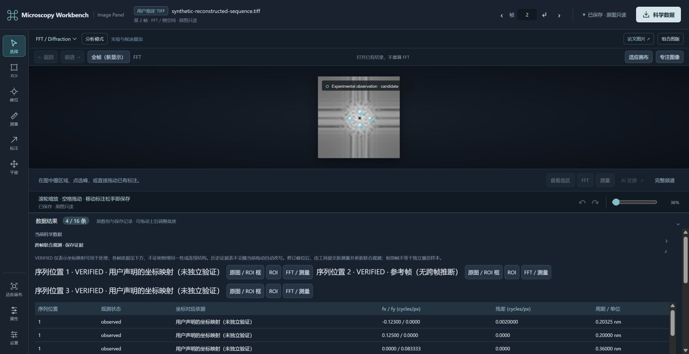
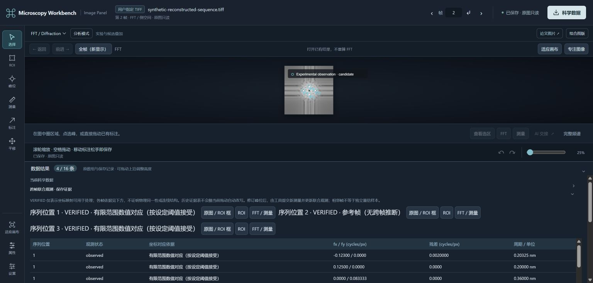

# R2 integration closeout (2026-10-30)

PR #9 was merged first with merge commit `415daf86c4aa1767c01d4fbed77dcfddf0836c0e`.
PR #11 was then retargeted to main. This follow-up fixes the remaining evidence-label ambiguity before its merge.

`VERIFIED` remains the machine-readable eligibility status. The Panel now reads the
saved correspondence and displays the actual basis: reference frame (no inference),
user-declared coordinates (not independently verified), bounded numerical matching
(accepted under specified thresholds), or unknown basis. Both the navigation and
reflection table show the basis. Legacy joint records also recover it from their
original correspondence; no scientific object is rewritten.

Executed on Windows, Node24.16 and independent Python3.13.2:

- Focused UI/contract checks: 70 PASS. Lightweight npm test: 272 PASS, 4 existing opt-in SKIP.
- Actual MCP/Python reopened the previous synthetic numerical correspondence and
  composed an explicitly declared translation with identical mapped ROIs. The
  existing four complex FFT objects and all their hashes remained unchanged.
- Actual Chrome showed both labels, the reference-frame exception, source statement
  and limitation. Expanding/collapsing the saved evidence table did not run science.
- Independent integration review found no additional P0/P1 in scientific identity,
  manual override preservation, partial request recovery and context CAS.

This is a presentation/compatibility repair, not new physical validation of frame
identity or continuity. The historical R2 numerical and fresh Agent evidence remains
in [SEQUENCE_PLUGIN_ACCEPTANCE.md](SEQUENCE_PLUGIN_ACCEPTANCE.md). Combined main
regression is performed after the sequential merges; no real GMS/private specimen
or Mac qualification is claimed here.
