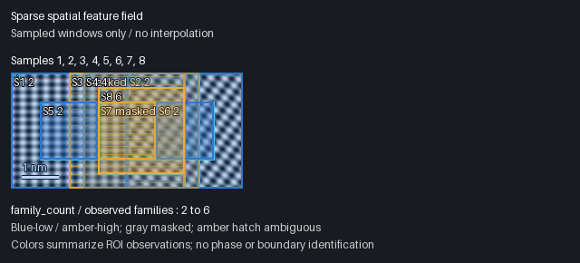
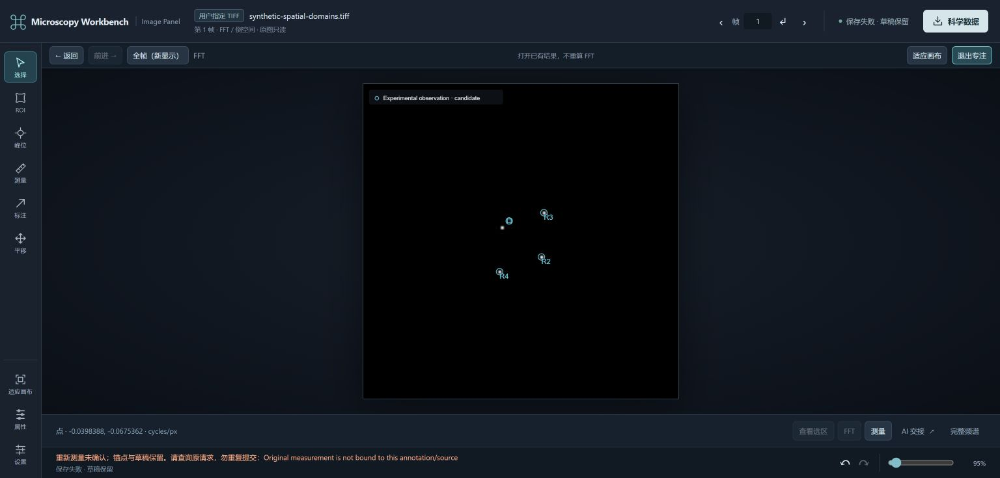
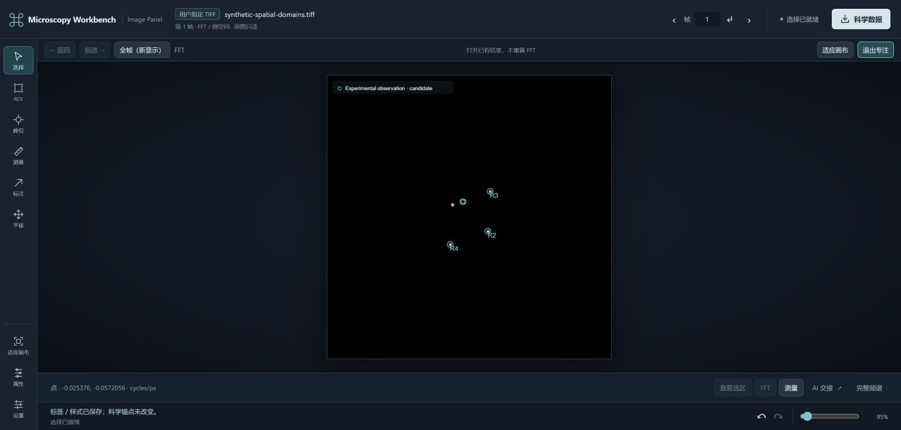

# R3 acceptance record — spatial atlas and sparse structural field

Recorded 2026-10-30 on Windows. This record covers public synthetic data and
actual MCP/Python execution. It distinguishes numerical/protocol acceptance,
a fresh model's tool use, and browser interaction. The final browser navigation
and corrected-anchor workflow passed within the scope recorded below. The
separately gated actual binding test remains **PENDING** in this revision;
the preceding Windows run exceeded its 240-second bound and is not a pass.

## Integration base and issue status

GitHub state was checked on 2026-10-30:

| Item | Observed state |
| --- | --- |
| [PR #9](https://github.com/wuchqwq/microscopy-workbench/pull/9) | Merged first, commit `415daf86c4aa1767c01d4fbed77dcfddf0836c0e`. |
| [PR #11](https://github.com/wuchqwq/microscopy-workbench/pull/11) | Merged after retargeting to main, commit `4e0ee4437a9807109e960e072b228f74ad00da3e`. This is the R3 branch base. |
| [Issue #10](https://github.com/wuchqwq/microscopy-workbench/issues/10) | Closed as completed for R2. |
| [Issue #8](https://github.com/wuchqwq/microscopy-workbench/issues/8) | Open; includes the R3 sparse structural feature-field requirement and broader future work. |

The [R2 closeout](R2_CLOSEOUT.md) retains its own evidence. R3 is a bounded MVP,
not completion of all indexing, phase, twin, dislocation, GPA or reconstruction
capabilities in the parent issue. This document does not assert a later R3 merge
or issue closure.

## Executed scopes

| Evidence | Result | Actual scope |
| --- | --- | --- |
| Atlas/comparison smoke, run `r3-spatial-20261030-r3` | **PASS** | Actual plugin launcher → MCP stdio → independent Python; signed float32 source, six ROI spectra, finite signature hypotheses, committed measurement revision/FFT reuse, R2 joint input, named fresh-client recovery, Panel image content and HTTP. |
| Feature-field smoke, run `r3-field-20261030-r1` | **PASS** | Eight multiscale/shifted boundary windows, primitive FFT/detector comparison, independent direct DFT, sparse fields from atlas/comparison/R2, masks and unknown scale, JSON/CSV export/readback, context dependency fingerprints, fresh-client recovery and Panel images/HTTP. |
| `verification-fresh-agent.json` | **PASS_FRESH_MODEL_FIELD_SCOPE** | Actual new Codex model used candidate MCP and the packaged Skill on a separate public input; independently audited provider artifacts and tool logs. |
| Final Chrome navigation and scientific-anchor correction after the alias repair | **PASS, limited scope** | Field hotspot → saved FFT → original image → reload; actual pointer drag → new ordinary measurement → revised atlas/field; unchanged other observations and all six FFT hashes. Earlier failure remains recorded below. |
| Final lightweight `npm test` | **279 PASS / 5 SKIP** | Four existing opt-in skips plus the separately gated actual binding test; skipped tests are not passes. |
| Separately enabled actual binding test | **PENDING; prior TIMEOUT retained** | The Windows run exceeded 240 seconds during repeated display refreshes, without completing all assertions. A final bounded run is audited separately from the default lightweight suite. |
| R3 native plugin-discovery loading / full native-plugin model mode | **NOT_TESTED** | Explicit temporary MCP + packaged Skill loading is the fresh-model evidence. Earlier R2 native discovery is not qualification of this R3 loading mode. |
| Real specimen accuracy, dense phase segmentation, Mac/Linux client qualification, GMS | **NOT_TESTED** | No such qualification follows from these synthetic Windows runs. |

Public evidence: [sanitized acceptance summary](examples/r3/acceptance-summary.json),
[exported per-family CSV](examples/r3/feature-field.csv), and
[field image](examples/r3/feature-field.png). Original request journals, immutable
provider objects and complete reports are retained locally. The published JSON
is an evidence summary, not a replacement for those provider records; local
Panel connections and authentication fragments are deliberately excluded.

## Numerical and geometric checks

The six-window atlas fixture contains analytic A and B patterns, an A+B
superposition, a constant and square-symmetry controls. For 128-pixel windows,
A has bin vectors `(10,0)` and `(0,15)`; B has `(8,6)` and `(-9,12)`. Their
explicit proper rotation has cosine `4/5`, sine `3/5`, and angle
`36.86989764584402°`. The submitted antipodal equivalent is also retained;
square symmetry remains ambiguous, and a mixed signature retains extra families.

The separate field fixture has a genuine piecewise A|B boundary at source X=128,
eight shifted/multiscale windows of 128, 96 and 64 pixels, and separate constant
negative / seeded-noise controls. The analytic truth is generated without an FFT.
Scientific input remains signed float32, including negative values. Every saved
complex bin was checked with an independent direct DFT matrix using the same
explicit `window:none` and mean subtraction. Maximum absolute discrepancy was
`2.5964947499233707e-10` in both reported suites, below their unchanged `1e-7`
acceptance threshold. Known pure-window signed vectors also matched the analytic
tones. This oracle does not call the provider FFT or `numpy.fft`.

The pre-existing primitive `image_fft` → `image_peaks` →
`image_peak_measurements` path was compared with the atlas for one pure 128-pixel
ROI: complex arrays and selected measurement vectors were identical. This is a
same-provider composition baseline; the direct DFT supplies the independent
numerical check. It is not a reproduction or performance comparison of an NMF
or learned-model pipeline. See [method baseline](R3_METHOD_BASELINE.md).

Fields retained exact half-open source rectangles and included-pixel centroids,
ordinary measurement IDs, source/FFT hashes and unknown uncertainty. Physical
periods were independently checked as `1/hypot(fx/sx, fy/sy)` using the explicitly
supplied synthetic signed scales `sx=+0.025`, `sy=-0.03 nm/pixel`; no `2π`
factor or inferred scale was inserted. The uncalibrated R2 control kept physical
features null. R2 fields retained their actual frame identity and declared
coordinate-mapping basis. This smoke's R2 example uses a declared common grid;
it does not independently establish physical registration or continuity.

Feature materialization and comparison created no new FFT. Manual measurement
revision in the atlas suite changed downstream full-match acceptance while
preserving all source FFT objects/hashes. Fresh-client context reads created no
scientific objects; dependency fingerprints bound the exact saved atlas or
comparison. Export readback verified file hashes and 34 CSV rows' centers,
vectors, periods, measurement IDs and source-array provenance.

## Coverage, sensitivity and timing

These are metrics of the finite fixture and selected settings, not estimates of
specimen-wide accuracy or statistical confidence.

| Metric | Observed value / meaning |
| --- | --- |
| Field sample status | 8 samples: 6 `valid`, 2 `ambiguous`; usable fraction 75%, undetermined fraction 25%. |
| Selected ROI support union | 100% of this small source rectangle; overlapping windows are correlated. This is not a dense field, pixel classification coverage or segmentation accuracy. |
| Constant negative control | `insufficient_evidence`, zero detected families, display value null. Non-detection is not zero crystallinity. |
| Seeded noise control | `ambiguous`, four selected families, display value null; the detector limit prevents definitive display. |
| Pure A, 128 → 64 pixels | Family count unchanged; shortest selected pixel period changed by `+0.60952381 px`. |
| Pure B, 128 → 64 pixels | Family count unchanged; shortest selected pixel period changed by `+0.34186981 px`. |
| 128-pixel boundary window shifted 16 pixels | Selected family count changed by `-4`; shortest selected period unchanged. |
| Centered boundary, 128 → 64 pixels | Shortest selected period changed by `-2.13333333 px`. |
| Atlas/comparison end-to-end run | `227.210 s` from report timestamps, including validation, recovery and Panel HTTP. |
| Feature-field end-to-end run | `455.963 s`, including baseline, controls, export/readback, recovery and Panel. |
| Three primitive baseline tools | `32.364 s` for one pure ROI, summed from their per-call timings. This is not comparable to the eight-ROI suite as a speed ratio. |
| Fresh-model run | `266.046 s`, 15 formal calls with 14 completed and one refused. |

The local `metrics-review.json` corrects the interpretation of the original
field report's `baseline.elapsed_ms`: that original value also included oracle
verification. The primitive-only figure above uses its three individual tool
timings. The permanent smoke now separates that interval and generates unique
request/context IDs for each new output directory when reusing a workspace.
These reporting refinements did not change scientific calculations. Times are
observed end-to-end wall times on this Windows setup, not an optimized benchmark.
The smoke timers cover their MCP workflows; fixture generation and environment
installation are outside those intervals.

Window size and position changed finite Fourier sampling and mixture support.
Those changes remain visible rather than being presented as a physical boundary
localization error. The field image preserves ROI outlines and masked samples;
overlapping labels can be crowded, while the saved table retains exact values.



## Fresh-model evidence and refusals

The audited run used a fresh `gpt-6.1-sol` session with its configured `ultra`
reasoning setting preserved. It received a different public float32 boundary
input and an explicit synthetic XY scale of `0.02 nm/pixel`. The audit observed
formal tool calls only and no oracle access. The model chose four windows of
64, 96 and 32 pixels, `hann`/mean-subtracted FFTs and quadratic peak refinement.
Its physical field retained 2, 2, 4 and 1 reciprocal families. The last sample
remained `insufficient_evidence` with a masked display value.

The source bytes and supplied calibration remained unchanged; field creation
and query used the existing four FFTs. Actual PNG content was returned for
source preview, atlas, field, field query, Panel open and Panel current. The
field's saved/query PNG hashes agreed. The model saved named atlas/field context
references and opened the saved field in the Panel.

One `analysis_update` was **refused** with `SCIENTIFIC_BINDING_MISMATCH`: the
selected raw experiment did not match the calibrated immutable source used by
the atlas. The model reread the context and successfully saved compatible
atlas/field selections. The independent verifier corrected the harness's overly
broad success boolean: a CLI `status=failed` counts as refused, not completed.
Thus the record is 14 completed + 1 refused call, not 15 successful calls.

This is real fresh-model MCP use with explicit candidate loading. Native plugin
discovery/model loading and browser gestures were not tested by that harness;
seeing PNG blocks or a Panel HTTP response does not prove browser interaction.
Candidate snapshot files and the user's real configuration remained unchanged.
That fresh-model run used the frozen candidate snapshot before the final GUI
annotation-alias repair. It was not repeated against that last GUI change;
the later actual Chrome workflow and affected checks supply its separate evidence.

## Preserved failures and completed GUI scope

1. **Atlas smoke r1 — FAIL retained.** The first run reached context promotion
   after its numerical/control/revision checks, then failed with
   `SCIENTIFIC_BINDING_MISMATCH: Spatial evidence must bind the selected source dependency`.
   The adapter omitted the selected atlas dependency when promoting the
   comparison. The repair added the actual source fingerprint; a later complete
   run passed with explicit fingerprint assertions. The earlier failure was not
   relabeled or deleted.
2. **Fresh-model source-selection refusal — retained.** This was an enforced
   scientific binding boundary, as described above, not a successful mutation.
3. **Actual Chrome correction — initial failure retained.** A
   mouse drag saved the corrected-view annotation, but automatic remeasurement
   was refused because its new atlas annotation alias did not bind to the old
   measurement's original peak annotation ID. The saved annotation is not proof
   of a successful new measurement. This failed attempt preceded the repair and
   is not relabeled as successful by the later result.



**Final actual Chrome result: PASS for the following bounded workflow.** Clicking
the field's displayed sample-5 hotspot opened its original saved FFT; returning
to the original image and reloading retained the field evidence. This was an
actual browser interaction, separate from the prior MCP/HTTP checks.

After the binding repair, an actual pointer drag of the corrected-view alias
produced a new ordinary `image_remeasure` object
`9246aaaa73714b35a4fc8b7b65b16066`, using DC-to-peak coordinates
`[[0,0],[-0.025376033057851244,-0.05720557851239666]]` and period
`0.3994802459444198 nm`. The other three displayed measurement rows retained
their prior values. Formal atlas and field calls then created atlas
`578fcce931284aab87a28bf3f584f3da` and field
`6a1fabaebdb24d30969ed91551817573`. All six FFT IDs and SHA-256 hashes were
unchanged; the five unedited ROI measurement-ID lists were unchanged. The
public summary's `browser_revision` records these dependencies. The numerical
atlas/field algorithms were unchanged by this GUI binding repair.




This establishes the exercised hotspot/navigation/reload and one corrected-alias
drag/revision path. It does not extend the fresh-model snapshot, qualify every
browser gesture or replace the separately pending actual binding-test result.

## Environment and reproduction

Actual numerical acceptance used Windows x64, Node `24.16.0`, independent CPython
`3.13.2`, NumPy `2.5.4`, SciPy `1.18.1`, Pillow `12.3.0` and tifffile `2026.10.15`.
This was not GMS-managed Python. All fixtures were public synthetic arrays; no
private specimen, vendor binary or real DM-host execution was required.

From a checkout with the independent image dependencies installed, choose any
new absolute output directories. The scripts create their own output directory;
do not precreate it or reuse an existing one. Example PowerShell:

```powershell
$env:MICROSCOPY_PYTHON = 'C:\path\to\independent-env\Scripts\python.exe'
& $env:MICROSCOPY_PYTHON -m pip install -r requirements-images.txt

$env:MICROSCOPY_SMOKE_OUTPUT = 'D:\public-evidence\atlas-run-new'
node tools/smoke_domain_plugin.mjs

$env:MICROSCOPY_FEATURE_BASE_REPORT = Join-Path $env:MICROSCOPY_SMOKE_OUTPUT 'report.json'
$env:MICROSCOPY_SMOKE_OUTPUT = 'D:\public-evidence\field-run-new'
node tools/smoke_feature_field.mjs
```

Equivalent npm entrypoints are `npm run test:domains` and `npm run test:field`.
The reported field run explicitly reused a completed public atlas smoke's
workspace/R2 references. The field script also supports omitting
`MICROSCOPY_FEATURE_BASE_REPORT` to construct its own R2 fixture; that alternate
invocation is not the run reported above. `MICROSCOPY_SMOKE_OUTPUT` retains local
connection details for inspection; remove those details before publishing logs.

For a fresh-model acceptance, follow the [plugin setup](AUTOMATION_PLUGIN.md)
with a separate temporary client configuration and the packaged Skill, supply
a different public input and only sourced scale information, and independently
audit actual tool outcomes, image content, saved records and unchanged source
bytes. Running a Node smoke alone does not reproduce that model session.
