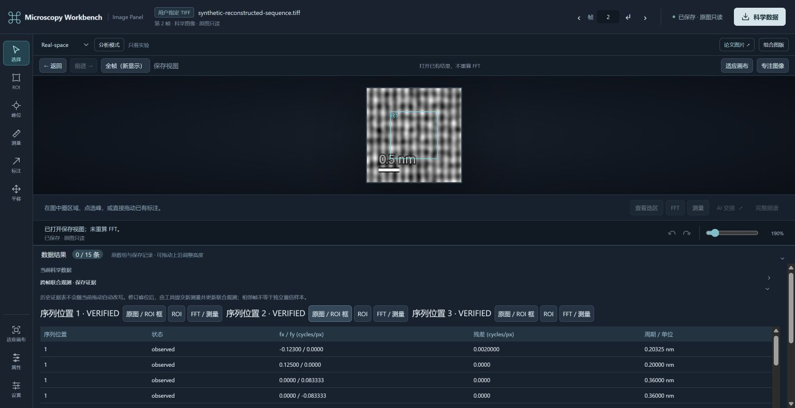
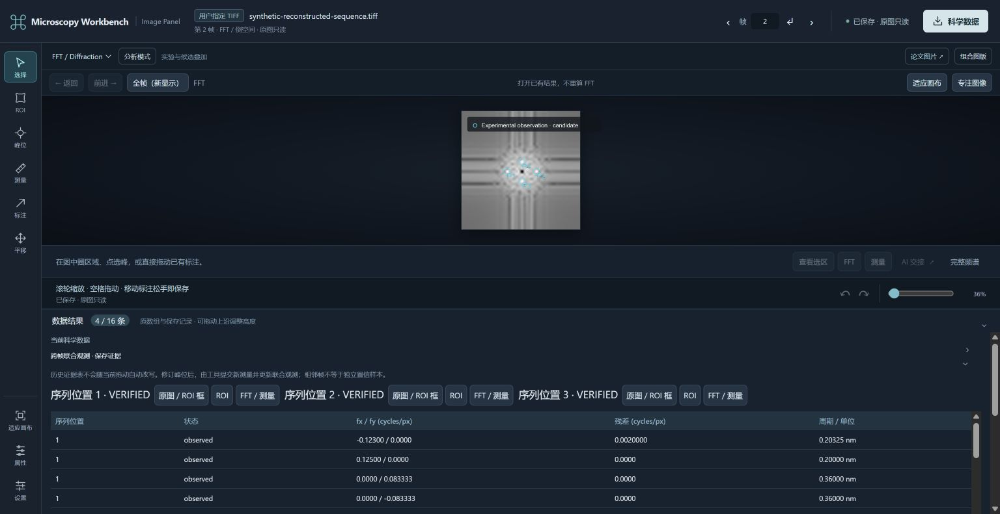

# R2 reconstructed-sequence plugin acceptance

Date: 2026-10-29. Issue #10, parent #8. This increment is stacked on PR #9
`5ac4b90ceea32fe0be3809b4241458d73ae5637a`; it does not merge that PR or main.
All scientific inputs below are newly generated public synthetic fixtures.
No private experiment, GMS runtime or new scientific dependency was used.
Implementation commit: `232037205a4228e36ac88f1897e10b713829e7ce`.

## What is now reusable

The installed MCP exposes `image_sequence_create`, `image_region_correspondence`
and `image_joint_observations`. [Exact scope and use](SEQUENCE_PLUGIN.md) describe
the caller-saved request IDs, frame order/meaning, integer correspondence,
ambiguous/out-of-view results and explicit previous-observation reuse. The
packaged `microscopy-automation` Skill covers this optional sequence path.

An Agent can select a different source and reference ROI, recover corresponding
regions, run existing FFT/peak/measurement tools, inspect extra or missing
reflections, return to the original/ROI/FFT views in the existing Panel, incorporate
a saved manual peak correction and recover a named task in another session.
The tool does not require the developer's temporary scripts or object IDs.

Scientific arrays and requests remain in the image provider's journals. The
AnalysisContext adds only `sequence`, `correspondence` and `observations` references
and dependency invalidation. A correspondence revision stales joint evidence;
display changes do not invalidate measurements. No second FFT or database exists.

## Executed environment and results

Windows 11, Node 24.16.0, independent CPython 3.13.2, NumPy 2.5.4,
SciPy 1.18.1, Pillow 12.3.0, tifffile 2026.10.15. The browser was actual Chrome
controlled through its connected browser interface. The fresh model client was
Codex CLI 0.165.0-alpha.1.2 using the installed package's MCP and packaged Skill.

| Scope | Result | Evidence |
| --- | --- | --- |
| Sequence identity and numerical correspondence | PASS | 7 targeted Python tests: integer truth, local change, periodic/constant ambiguity, absent mapping, out-of-view, mismatch, signed scales/units, origins, finite float range and journal integrity |
| Joint science, revisions and partial recovery | PASS | 7 targeted Python tests: direct DFT, geometric ambiguity, manual override persistence, source/FFT/calibration bindings, excluded frames, corrupt child and preoccupied unrelated request ID |
| Node compatibility and lightweight suite | PASS / 4 SKIP | `npm test`: 268 passed, 4 existing optional integration skips, 0 failed; 7.85 seconds reported by test runner |
| Plugin/schema and partial MCP error transport | PASS | 8 focused tests including installed-root relocation and structured partial children; an unrelated parent cannot be returned as recovered science |
| Existing real stdio science smoke | PASS | `npm run test:science`: TIFF, signed scale, ROI FFT, physical measurement, NPY/direct DFT, display revision, restart and Panel HTTP |
| New real stdio/Python sequence smoke | PASS | 217.933 seconds; separate new client, source hashes, all-bin DFT, unchanged FFT reuse, negatives and actual Panel HTTP |
| Actual browser correction | PASS | Original ROI and each saved FFT opened; one peak dragged and measured; formal joint revision changes one observation while the other frames and all FFT hashes remain unchanged; refresh keeps the updated table |
| Plugin installation/discovery | PASS | Isolated Codex plugin install/list and MCP resolution to cached 0.3.0 package; user configuration unchanged |
| Fresh model, different input | PASS | Installed package MCP + packaged Skills; independent new TIFF, no supplied object IDs/ROI/truth, formal tools, actual PNG responses and named context |
| Fresh read-only model recovery | PASS with explicit live-Panel limitation | Named context and numerical/PNG results restored; 182 previous authoritative files unchanged, zero new records/FFTs. No live registered Panel existed, so `image_panel_current` correctly refused |
| Another fresh model explicitly reopens the Panel | PASS | Task name only; reads saved evidence, opens its existing view, then reads the live Panel. Three PNG responses; 181 scientific/request/context files unchanged, zero new science or FFTs, only an auxiliary Panel receipt |
| Native-plugin-mode full model session | NOT_TESTED | Installation/discovery is not the same as a complete model run in that loading mode |
| Private experiment / complex reconstruction sequence / real DM / Mac | NOT_TESTED | No qualification beyond the real scalar spatial frame range of this increment |

The installed snapshot used for model acceptance predates only the lazy import
and stricter failed-child recovery checks. Normal scientific algorithms and
schemas match; final targeted tests exercise those subsequent fixes separately.

## Independent numerical truth

The 96 x 96 three-frame uint16 fixture uses reference index 1 and half-open ROI
`[24,24,72,72]`. Known target-minus-reference shifts are `[-3,2]`, `[0,0]`,
`[4,-2]`. Signed calibration is X `+0.025`, Y `-0.03` nm per original pixel,
explicitly synthetic. Original dtype and every selected source pixel are checked.

The reference contains frequencies `(±0.125,0)` and `(0,±1/12)` cycles/pixel.
With this anisotropic signed calibration their DC-to-peak periods are 0.2 nm
and 0.36 nm. A real added local tone in the third frame produces the extra
`(±1/6,0)` pair, retained as unmatched evidence, with period 0.15 nm. No phase,
depth resolution or independent statistical confirmation is inferred.

All complex bins are compared against an independent direct DFT, not another
call to the implementation FFT. Maximum absolute error is `3.98617e-8` under
the predeclared `1e-6` tolerance. Periodic controls remain ambiguous; an
unsourced identity mapping, changed physical sampling and out-of-view ROI do
not create FFTs for an unverified frame. Pixel-only inputs produce no fabricated
nm spacing. [Protocol evidence](examples/sequence-plugin/mcp-verification.json)
and the [actual CSV](examples/sequence-plugin/joint-observations.csv) preserve
frame/grid/calibration/request provenance.

## Fresh Agent and GUI are separate evidence

A clean model session used another generated TIFF (120 x 120, seed 314), the
installed server and packaged Skill, and chose ROI `[20,20,100,100]` itself.
It was not given the generator oracle or developer-session references. Its 18
tool calls had 16 successes and two correct refusals: no Panel existed yet;
one attempted single-frame context binding used a sequence-source calibration
wrapper. It reread the context and saved valid sequence references. Five valid
PNG blocks returned through MCP. There was no shell/ad-hoc scientific execution.

Independent audit reconstructed every source pixel from the generator definition,
checked the recovered shifts, all 80 x 80 Hann spectrum bins (direct DFT maximum
error `2.27477e-8`) and 26 signed-scale measurements. The model selected its
correspondence thresholds before estimating; actual correlations 1.0/0.98708
and margins 0.1557/0.1517 also satisfy the stricter 0.9/0.03 fixture criteria.
Two new reflections stayed unmatched. Its original thresholds are retained.

The second clean session was intentionally read-only. It recovered by task name,
returned a saved PNG and accurately reported that there was no live Panel;
it did not claim to see a currently running GUI. Full audit:
[fresh-session evidence](examples/sequence-plugin/verification-new-agent.json).

A third fresh session was explicitly allowed to reopen the saved GUI. Given only
the task name, it read the context, confirmed there was no live Panel, inspected
the saved joint object, called `image_panel_open` and read the new current Panel.
It made five calls in 84.292 seconds (four successes and the expected no-live-Panel
refusal), received three valid PNGs, and recovered the saved 80 x 80 reference
FFT, eight markers and 26-row table. All 181 scientific/request/context files
were byte-identical afterward; only an auxiliary Panel receipt was created.
This closes explicit GUI reopening without claiming automatic Panel resurrection.

Separately, actual browser navigation opened the original image with its mapped
ROI and the third saved FFT. A pointer drag moved one scientific anchor to
`[0.1417666627494878,-0.008383332089671569]` cycles/pixel and the existing GUI
created an ordinary revised measurement (0.176132382063942 nm). Submitting that
saved measurement to a new joint record left both other frames' measurements
and all four FFT objects/hash values unchanged. One previous match became
non-detected and the moved point remained unmatched rather than forcing it into
the old correspondence. Refresh showed the new saved table.





[After-drag CSV](examples/sequence-plugin/joint-after-drag.csv) and
[browser/source/FFT verification](examples/sequence-plugin/browser-verification.json)
are actual outputs, not mock tables. The saved historical table does not silently
follow a local gesture; the tool explicitly creates the new joint observation.

## Failures retained and small fixes

- Initial smoke R1 stopped at a wrong harness provider alias (`images` instead
  of the registered `image`). It was not counted as success; R2 reran the whole
  protocol smoke with the correct alias.
- A new Node test initially used a relative workspace path, and the existing UI
  VM harness initially lacked the imported table renderer. Both harness faults
  were fixed; no scientific assertion or numerical tolerance was removed.
- Failed joint operations initially kept useful child records only on disk.
  The original `image_result` now exposes bounded, validated child identities
  through structured MCP error content. A similarly named record belonging to
  another frame is marked unrelated, never adopted. Querying does not retry.
- Profiling showed every Python read eagerly imported the SciPy signal stack.
  Moving that import into translation estimation reduced single paired reads
  from 3.48 to 2.03 s (frame), 3.49 to 1.96 s (view), 5.26 to 2.97 s (joint).
  These are same-input fresh-process samples, **not** an end-to-end browser
  latency claim. [Measurements](examples/sequence-plugin/read-profile.json).

## Reproduce and remaining boundary

Use an independent environment with `requirements-images.txt`. In PowerShell:

```powershell
$env:MICROSCOPY_PYTHON = 'C:\path\to\independent-env\Scripts\python.exe'
$env:MICROSCOPY_SMOKE_OUTPUT = 'C:\existing-parent\new-sequence-trial'
npm run test:sequence
```

The output directory must be new. The smoke runs actual stdio/Python and leaves
its public fixture, oracle, CSV and report. With retained evidence it also leaves
the Panel connection for browser review. Use the plugin installation instructions
in [AUTOMATION_PLUGIN.md](AUTOMATION_PLUGIN.md), then ask a new session to inspect
the generated TIFF, select a reference ROI, establish correspondence, save joint
observations and a named task. Recovery uses that task name, not copied object IDs.

The main usability limit is still serial subprocess/read validation latency when
switching saved Panel views. The current small optimization does not remove all
waiting. R2 does not claim subpixel/affine registration, general complex sequence
admission, automatic multiphase indexing or definitive twins/dislocations/GPA.
Integer correspondence and reflection geometry are bounded evidence, not a
unique material interpretation.
