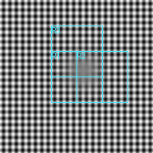
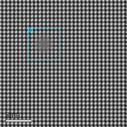
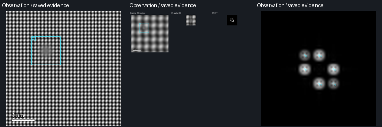

# Public F4b evidence

- [Frozen comparison plan](../../F4B_BENCHMARK_PREREGISTRATION.md)
- [Primary summary, original report hashes and retained failures](primary-summary.json)
- [Exact twelve-row entrance comparison CSV](primary-comparison.csv)
- [Separate post-hoc scale diagnostic](scale-diagnostic.json)
- [Actual fresh-model decisions, image delivery and new-session recovery](fresh-agent.json)
- [Final compiled original-record read-only supplement](final-readonly.json)
- [Full scope and reproduction](../../F4B_ACCEPTANCE.md)

Primary64px image scanning missed both positive inputs. The field also missed
same-carrier contrast depression; manual attention proceeds without requiring
that field. The positive new-model example below is a different192px input and
proves tool composition, not a replacement benchmark win or a material defect.

Actual MCP source/ROI feedback from the independent new Agent:

Explicit synthetic manual attention and its existing numerical evidence:

All images are display feedback. Actual numerical arrays remain in the
scientific workspace/export with their own dtype, calibration and hashes. No
private specimen, browser screenshot or unique phase/twin/dislocation claim is
represented here.
