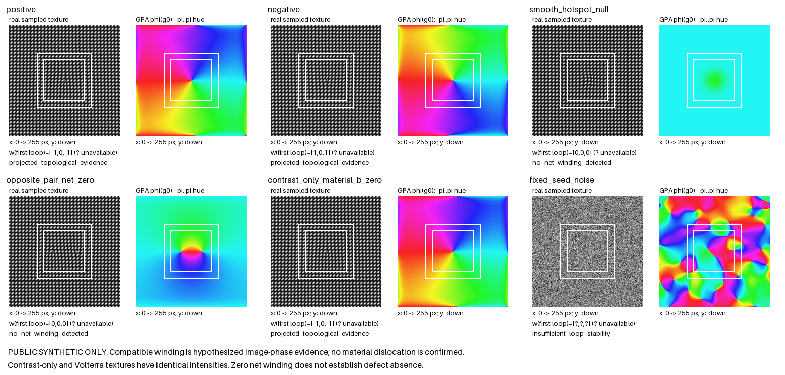

# F3a bounded physics evidence

These results cover an independent analytical Volterra texture oracle and the
actual public synthetic image → unwindowed FFT → unchanged classical GPA →
saved wrapped bands → explicit rectangular topology paths chain. They do not
validate real specimens, material dislocations, native DigitalMicrograph/GMS,
private images, 3D uniqueness, or a general noise/aliasing discriminator.

The first execution ran 17 tests. Sixteen passed; the exterior-loop test failed
because its extra nested loop `[36,36,76,76]` crossed the existing GPA 40-pixel
edge guard. The reported winding was correctly zero, but the path was correctly
invalid. The correction replaces that invalid helper loop with
`[44,44,68,68]` inside the preregistered exterior rectangle `[40,40,72,72]`.
The analytical truth, primary loops, aperture, GPA qualification and numerical
tolerances were unchanged. The complete first failure is retained in
`physics-results.json:failure_history`.

The current run passes all 17 physics tests. Raw output, measured cases, GPA
quality diagnostics and unchanged failure history are in `physics-results.json`.
The generator and numerical thresholds remain independently reproducible from
the source and `tests/fixtures/topology_truth.json`.

| Actual image → GPA case | Both nested-loop winding vectors | Saved result |
| --- | --- | --- |
| Positive `b=[8,0]` pixels | `[-1,0,-1]`, `[-1,0,-1]` | projected topological evidence, hypothesized |
| Negative `b=[-8,0]` pixels | `[1,0,1]`, `[1,0,1]` | projected topological evidence, hypothesized |
| Single-valued smooth hotspot | `[0,0,0]`, `[0,0,0]` | no net winding detected |
| Enclosed opposite-core pair | `[0,0,0]`, `[0,0,0]` | no net winding detected |
| Contrast-only vortex, material `b=0` | `[-1,0,-1]`, `[-1,0,-1]` | projected image-phase evidence only |
| Fixed seed random image | See eligible values and diagnostic-only sums in JSON | insufficient loop stability |

Positive and negative fitted pixel Burgers X components are
`7.999999999999997` and `-7.999999999999997`; their Y components are zero.
The noise arithmetic sums `[0,-1,2]`, `[2,-1,-1]` are retained in explicitly
named `diagnostic_winding_cycles_by_loop`; they do not become scientific
conclusions because the prescribed paths do not satisfy stable eligible-loop
evidence. After the semantic followup, an invalid path has JSON `null` and NPY
`NaN` scientific winding, rendered `?` in the figure. Any still eligible path
retains its own numerical winding, without implying stable-loop evidence.
Valid physical truth, tolerances and status assertions are unchanged. The
original failure history above remains verbatim evidence of the earlier run.

The contrast-only vortex intentionally has identical intensity data and winding
to the Volterra texture while its defined material displacement is zero. A
successful compatible winding is therefore always `hypothesized`, conditional
projected image-phase evidence. The invisible reflection and opposite-core
pair demonstrate that zero winding does not establish defect absence. The
fixed noise case and high-charge alias case are bounded examples of refusal;
small sampled phase steps cannot exclude hidden aliasing or coherent contrast
vortices in general.
